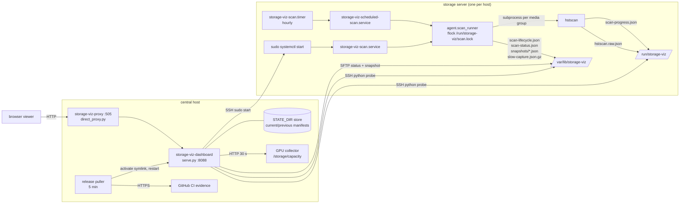

# Storage monitor: as-is architecture map (main at 06cdd5f)

This map describes the storage monitor as it exists on main at 06cdd5f. It is
the input for the redesign. It does not propose a target. Each structural cause
from [bug-catalog.md](bug-catalog.md) (S1-S5) points to the section where it
lives:

| Cause | Where it lives in this map |
|---|---|
| S1 duplicated judgments | §5, plus the field aliases in §2.6 |
| S2 implicit state machines | §4.1-§4.3, and §3.1 and §3.3 for the state they mutate |
| S3 viewer globals | §3.4 and §4.4 |
| S4 error boundaries | §6 |
| S5 agent publication, identity, deployment | §4.1, §7, and §2.1-§2.2 |

All paths are relative to `apps/storage-monitor/`. `file:N` means line N at
06cdd5f. "Inferred" marks claims read from code but not run.

## 1. Components and processes

### 1.1 What runs where

| Host | Process | Unit / trigger | Code |
|---|---|---|---|
| Each storage server | Scheduled scan (due media groups only) | `storage-viz-scan.timer`: `OnCalendar=*-*-* *:00:00 UTC`, `RandomizedDelaySec=5m`, `Persistent=true`, `Unit=storage-viz-scheduled-scan.service` (deploy/systemd/storage-viz-scan.timer:5-9) | `python3 -m agent.scan_runner --config /etc/storage-viz/scanner.yaml --scheduled` |
| Each storage server | Manual full scan | `storage-viz-scan.service` (`Type=oneshot`, `User=root`), started by `monitoring` through sudo | deploy/systemd/storage-viz-scan.service.in:6-7 |
| Each storage server | Scanner binary `hstscan` | `subprocess.run(argv, shell=False)` once per due group, from `run_once` | agent/scan_runner.py:347, scanner/hstscan.c |
| Central host | Dashboard: HTTP API, static viewer, pollers, rescan jobs | `storage-viz-dashboard.service`, `User=storage-viz`, binds 127.0.0.1:8088, `STORAGE_VIZ_TRUSTED_PROXY=1` | deploy/systemd/storage-viz-dashboard.service.in:7-18, viewer/serve.py |
| Central host | Public proxy on port 505 | `storage-viz-proxy.service` → `storage-viz-proxy-launcher.py` execs the release's `direct_proxy.py` | deploy/server/systemd/storage-viz-proxy.service:43-47, deploy/server/storage-viz-proxy-launcher.py:65-119, README.md:50 |
| Central host | Release puller | `storage-monitor-release-puller.timer` (`OnBootSec=2min`, `OnCalendar=*:0/5`, `RandomizedDelaySec=90s`) → `storage-monitor-release-puller.py` | deploy/server/systemd/storage-monitor-release-puller.timer:5-8 |
| Central host | GPU collector (another app) | Provides `GET 127.0.0.1:$STORAGE_VIZ_CAPACITY_PORT/storage/capacity` | collector/live_capacity.py:1, :93 |
| Browser | Viewer SPA | classic `<script>` tags, one global scope | viewer/index.html:228-234 |

The installer renders the two scan units from one template. The scheduled unit
is a sed-edited copy that adds `--scheduled` and `SuccessExitStatus=75`
(deploy/install-agent.sh:195-203). `scan_runner.main` exits 0 on complete,
partial or not-due, exits 75 on a lock conflict, and exits 1 otherwise
(agent/scan_runner.py:1138-1147). Only the scheduled unit treats 75 as success.

### 1.2 Threads inside the dashboard process

All singletons are built at import time (viewer/serve.py:280-384). The pollers
start in `__main__` (viewer/serve.py:746-756).

| Thread | Cadence | Work |
|---|---|---|
| HTTP connection threads (`ThreadingTCPServer`, daemon) | per request | `Handler.do_GET` / `do_POST` (viewer/serve.py:739-741) |
| `storage-viz-central-poller` | 900 s, clamped to 600-900 (collector/service.py:21, :224); the wait starts after `poll()` returns (viewer/serve.py:336-343) | `poll_background_once` queues one status read per server (collector/service.py:231-233) |
| `storage-viz-status-reader` × ≤4 | on demand | `_poll_fleet_server(defer_snapshot=True)` (collector/service.py:22, :214) |
| `storage-viz-snapshot-pull` × ≤2 | on demand | `_finish_deferred_pull` (collector/service.py:23, :215, :304-314) |
| `storage-viz-telemetry-poller` | 5 s (collector/service.py:24) | `poll_scan_status_once` starts one telemetry worker per server that is due (collector/service.py:426-443) |
| Per-server refresh worker | when the published generation differs from the cached overview generation | `poll_server(observed_publication=…)` (collector/service.py:461-471) |
| Capacity poller | 30 s | GPU collector `/storage/capacity`, 2 s timeout, 1 MiB cap (collector/live_capacity.py:17, :90-104) |
| Rescan job thread | one per accepted POST | `jobs._run` → `service.manual_rescan` (collector/jobs.py:117-119, :176-194) |

Telemetry gating per server (collector/service.py:432-440): skip under 5 s;
between 5 and 60 s, observe only if the last observation said `running` or the
persisted `active_job.state` is `requested`/`running`. That check reads
`state.json` from disk for every server every 5 s (collector/service.py:438).
Over 60 s, always observe. `_DaemonWorkQueue.submit` replaces a pending task for
the same server and drops a task for a server that is already running
(collector/service.py:166-183).

### 1.3 How the parts talk

Central starts every connection. The SSH user is always `monitoring`. Every
call uses
`-o BatchMode=yes -o StrictHostKeyChecking=yes -o IdentitiesOnly=yes -o ConnectTimeout=10 -o UserKnownHostsFile=<per-server> -i <per-server key>`
(collector/transport.py:229-238).

| Operation | Command | Timeout / cap | Code |
|---|---|---|---|
| Status pull | `sftp -b -` with `get /var/lib/storage-viz/scan-status.json`, wrapped in a Python launcher that sets RLIMIT_FSIZE | 30 s / 64 KiB | collector/transport.py:103-117, :19, :25, :36-50 |
| Snapshot pull | `sftp get /var/lib/storage-viz/snapshots/<generation>`, then a second status read to detect a race | 3600 s / min(byte_size, 512 MiB) | collector/transport.py:157-172, :20, :26 |
| Telemetry probe | `ssh … python3 -c <REMOTE_OBSERVATION_SCRIPT>` reads the lifecycle, status and progress files and runs `systemctl show` and `busctl` | 10 s / 48 KiB stdout | collector/transport.py:119-155, collector/scan_telemetry.py:108-144 |
| Active state | `ssh … /usr/bin/systemctl show --property=ActiveState --value storage-viz-scan.service storage-viz-scheduled-scan.service` | 10 s / 64 chars | collector/transport.py:22, :174-188 |
| Rescan | `ssh … sudo -n /usr/bin/systemctl start storage-viz-scan.service`. The unit is oneshot, so this blocks until the scan ends. | 6 h | collector/transport.py:21, :30, :190-193 |
| Live capacity | HTTP GET to the local GPU collector | 2 s / 1 MiB | collector/live_capacity.py:90-104 |
| Browser ↔ dashboard | HTTP JSON (§2.4) through the proxy | | viewer/serve.py:590-709 |

## 2. Data shapes end to end

### 2.1 Scanner raw JSON (hstscan → `/run/storage-viz/hstscan.raw.json`)

Emitted at scanner/hstscan.c:1407-1508:

- Top level: `schema_version`, `hostname`, `scanner_version` (the constant
  `"0.1.0"`, :45), `scan_started_unix` (`time(NULL)` at process start, :1339),
  `scan_duration_sec` (a float, :1412), `run_as_root`.
- `mounts[]` (:1416-1435): `path, fstype, df_total, df_used, df_avail,
  df_use_pct, scanned_bytes, scanned_files, scanned_dirs, errors, tree`.
  `df_*` is read by `statvfs` after each root's walk (`fill_df`, :1173-1184,
  called at :1382). `df_use_pct = ceil(used*100/(used+avail))` (:1182-1183).
- `tree` nodes: `name, kind, bytes, files, uid, mtime, other_bytes, children`
  (:1141-1149).
- `users[]`: `uid, name, bytes, files, by_mount{path:bytes}` (:1438-1460).
- `top_files[]`: `path, kind, bytes, uid, owner, mtime` (:1464-1477).
- `stale[]`: the same fields plus `age_days`, computed from `time(NULL)` per
  file during the walk (:788-789, :1481-1495).
- `blocked[]`: `path, reason` (:1498-1506).
- Invalid UTF-8 becomes `�`, so distinct names can collide (:1097-1102,
  A7).

`scan-progress.json` has one writer, hstscan `progress_write` (mkstemp, 0640,
rename; scanner/hstscan.c:1112-1136). Its fields are `phase, run_id,
current_root, updated_unix, scanned_bytes, scanned_files, scanned_dirs,
roots_completed, roots_total`. It is written at most every 2 s unless forced
(:1116), and forced at each root start and at `"publishing"` (:1351, :1389).

### 2.2 Agent outputs (`/var/lib/storage-viz/`)

**Snapshot** `snapshots/<server>-<started>-v1.json`. `run_once` merges the
captures and calls `_enrich_payload` (agent/scan_runner.py:374-397, :752-821):

- `_merge_captures` concatenates `mounts` and `blocked`, re-sorts `top_files`
  and `stale`, and sums `users` (:508-527).
- Each mount gains `mount_id` (from the mountinfo id or `<id>-root-data`,
  `_logical_mount_id` :861-867), `scan_root`, `storage_media`,
  `storage_media_confidence` and `capacity_id` (:765-768).
- `selected_roots[]` comes from `_root_record` / `_skipped_record`
  (:870-945). Its fields are `mount_id, major_minor, mount_source, mount_root,
  mountpoint, scan_root, fstype, status, scanned_*, blocked_count, error_count,
  error_code` plus the media fields. Complete and partial roots also get
  `scan_finished_unix` (:383-385).
- Top-level overrides (:390-395): `server_id`; `scan_started_unix` = the
  minimum over fresh captures; `scan_finished_unix` = runner clock after the
  last scanner exit (:357, :387); `scan_duration_sec` as an int;
  `scan_generation` = `<server>-<started>-v1` (:1006); `config_digest`
  (:154).
- The schema documents `df_observed_unix` (docs/schema-v1.md:172-175), but no
  agent or scanner code emits it. Central falls back to the root's and then the
  snapshot's `scan_finished_unix` (collector/live_capacity.py:145-149).

**Status pointer** `scan-status.json` (agent/scan_runner.py:409-427):
`generation` (the file name *with* `.json`), `byte_size`, `sha256`,
`scan_finished_unix`, `server_id`, `config_digest`, `status`,
`retained_generations` (keeps 2), and the optional `slow_capture{token,
fingerprint, slot, finished_unix}` (:496-500). It is written with file and
directory fsync, and rolled back to the prior bytes on error (:1039-1082).

**Lifecycle** `scan-lifecycle.json`. Its only writer is the
`publish_lifecycle` closure (:288-294), which merges `**fields` into one dict.
Fields: `server_id, state, phase, started_unix, finished_unix, run_id,
estimate_duration_sec, estimate_by_plan, last_finished_unix,
last_duration_sec, updated_unix, scan_plan, roots_total, roots_completed,
progress_run_id, scanned_files, scanned_dirs, scanned_bytes, error_code,
generation` (:266-298, :331-332, :345, :374, :436-439). No fsync. Write errors
are swallowed (:293-294).

**Slow-capture cache** `slow-capture.json.gz` (gzip level 1, atomic;
`_persist_slow_capture` :503-505).

### 2.3 Collector store (`STATE_DIR`, default `/var/lib/storage-viz-dashboard/state`)

| Path | Content | Writer |
|---|---|---|
| `<sid>/current.json`, `<sid>/previous.json` | manifest `{"snapshot": name\|null, "state": name\|null}` | `_commit_pair` (collector/store.py:310-313) |
| `<sid>/snapshot-v2-<sha256>.json` | payload re-encoded with `sort_keys`. The name carries the remote sha, but the bytes differ from the remote file. | collector/store.py:303, :479 |
| `<sid>/state-v2-<uuid32>.json` | state record (below) | collector/store.py:306-307 |
| `<sid>/store.lock`, `<sid>/generations.lock` | flock files (§3.2) | collector/store.py:216-235, :342-350 |
| `scan-duration-history/<sid>.json` | `{"full"\|"ssd": [[finished_unix, duration_sec], …]}`, at most 5 each | collector/duration_history.py:15-23, `_record_duration` collector/service.py:390-399 |

The state record (collector/store.py:29-46) holds:

- `snapshot_availability` (available|absent)
- `freshness` (fresh|stale|unknown)
- `latest_pull_status` (succeeded|unreachable|invalid_snapshot|not_installed)
- `latest_scan_result` (complete|partial|failed, default failed)
- `configuration_sync` (in_sync|drifted|unknown)
- `active_job`: null or `{id, server_id, kind, state ∈ requested|running|succeeded|failed, actor, requested_unix, started_unix, finished_unix, result_code}` (collector/store.py:415-462)
- `last_error_code`, `last_error_message` and `last_error_unix`, always set or cleared together

`snapshot.validate_download` only validates. It checks size and sha, server and
digest linkage, `finished == started + duration`, the generation format, at
least one complete root, root-derived status, tree sums and size limits
(collector/snapshot.py:68-195). It returns `ValidatedSnapshot`
(collector/snapshot.py:42-49). Unknown keys pass through.

### 2.4 API payloads

| Route | Builder | Fields |
|---|---|---|
| `GET /api/session` | `Handler._session` (viewer/serve.py:541-559) | `authenticated, actor, can_rescan, csrf_token` and Set-Cookie |
| `GET /api/servers` | `PollService.server_summaries` (collector/service.py:473-493), then `live_capacity.project` per overview (viewer/serve.py:637-644) | `{data_mode, servers:[{id, display_name, order, snapshot_availability, freshness, latest_pull_status, latest_scan_result, configuration_sync, mount_count, overview_snapshot, active_job, scan_status}]}` |
| `overview_snapshot` (embedded) | `_overview_snapshot` (collector/service.py:57-94) | `server_id, scan_generation, scan_finished_unix, scan_duration_sec, estimate_duration_sec, selected_roots[…], mounts[…, capacity_observed_unix], users[{uid,name,bytes}]` |
| `GET /api/servers/<id>` | **No such route.** It falls through to 404 `not found` (viewer/serve.py:678). | — |
| `GET /api/servers/<id>/snapshot` | `SnapshotResponseCache.get` (viewer/serve.py:399-427) | the full stored payload, with mounts projected by live capacity (collector/live_capacity.py:132-168) |
| `GET /api/servers/<id>/scan-status` | `scan_status_for_api` → `_status_with_history` (collector/service.py:401-424); `capacity` added at viewer/serve.py:645-658 | `empty_status` keys (collector/scan_telemetry.py:7-12): `state, phase, started_unix, finished_unix, updated_unix, observed_unix, scanned_*, roots_*, last_finished_unix, last_duration_sec, estimate_duration_sec, estimate_max_duration_sec, published_finished_unix, snapshot_finished_unix, generation, snapshot_generation, published_generation, scan_plan, schedule_mode, next_run_unix, timer_state, current_root, error_code, progress_available`, plus `capacity{scan_generation, mounts}` |
| `GET /api/servers/<id>/job` | `RescanJobManager.job_for` (collector/jobs.py:122-126) | `{job: active_job\|null}` |
| `POST /api/servers/<id>/rescan` | `_handle_rescan` (viewer/serve.py:680-709) → `request_rescan` (collector/jobs.py:65-120) | 202 `{status, job, audit}`; 404 `UNKNOWN_SERVER`; 409 `ACTIVE_JOB`; 429 `COOLDOWN`/`GLOBAL_CONCURRENCY`; 503 `ACTIVE_STATE_FAILED` |

### 2.5 Viewer models

- **Bootstrap** `{mode, dataMode, data_mode, session, summaries, snapshots}`
  carries the data mode twice (viewer/app.js:534-541, :619). In static mode
  the browser fabricates summaries with `freshness:"fresh"` and
  `latest_pull_status:"succeeded"` (viewer/app.js:513-524).
- **Overview row** `buildOverviewServer` (viewer/overview.js:451-474):
  `display_name→displayName`, `mount_count→mountCount`, plus
  `capacityGroups, aggregate, primaryStatus, secondaryStatus`.
- **Overview mount** `summarizeMounts` (viewer/overview.js:163-211):
  - `df_used→usedBytes` and `df_total→totalBytes`
  - `df_avail→availableBytes`, also stored as `freeBytes`
  - `df_use_pct→capacityPct`, plus a derived `usedPct`
  - `capacity_observed_unix ?? df_observed_unix → capacityObservedUnix`
  - `storage_media|block_media→media`
- **Detail capacity group** `groupDetailCapacityMounts`
  (viewer/data-client.js:411-458) is a second model of the same mounts with
  different merge rules (§5).
- **Detail snapshot** `DATA` is mutated in place by `normalizeDetailSnapshot`,
  which filters `/boot` and recomputes user bytes (viewer/data-client.js:320-332),
  and by the scan monitor, which writes `DATA.mounts` (viewer/app.js:83). `DATA`
  is the same object held in the detail cache and in the overview entries.
- **Scan status** `scanStatusModel` (viewer/scan-status.js:51-97) maps:
  - `max(last_finished_unix, published_finished_unix, snapshot.scan_finished_unix) → lastFinished`
  - `estimate_duration_sec`/`estimate_max_duration_sec → eta`/`slowEta`
  - `updated_unix → heartbeat`
- **Table rows**:
  - Top files: `{...file, age: daysAgo(mtime)}` (viewer/tables.js:180).
  - Stale: the server's `age_days` (viewer/tables.js:218).
  - The Age column sort key is `age` in one table and `age_days` in the other (viewer/index.html:169, :192).

### 2.6 One meaning, many names

| Meaning | Names and places |
|---|---|
| Generation id | snapshot `scan_generation` (no `.json`, agent/scan_runner.py:394); status `generation` (with `.json`, :410); lifecycle `generation` (:436); telemetry `published_generation` (`.json` stripped, collector/transport.py:148); scan-status `snapshot_generation` (collector/service.py:407, :417); store file `snapshot-v2-<sha256>` (collector/store.py:303) |
| Last good scan finish | payload `scan_finished_unix`, status `scan_finished_unix`, lifecycle `finished_unix`/`last_finished_unix` (agent/scan_runner.py:387, :413, :437); telemetry `published_finished_unix` (collector/transport.py:149); scan-status `snapshot_finished_unix` (collector/service.py:418); viewer `lastFinished` (viewer/scan-status.js:51-97) |
| Capacity observation time | per-root `selected_roots[].scan_finished_unix` (a reused HDD capture can be up to 3 h old, agent/scan_runner.py:385); `df_observed_unix` (documented, never emitted); `capacity_observed_unix` (live projection, collector/live_capacity.py:145-165); viewer `capacityObservedUnix` |
| Scan outcome | snapshot root-derived status (agent/scan_runner.py:784-820, collector/snapshot.py:188-190); status `status`; store `latest_scan_result` (collector/store.py:372-376); overview `legacy_success` (collector/service.py:68-71); scan-status `state`; viewer "complete" rule (viewer/scan-status.js:62) vs cleanup's complete-or-partial (viewer/selection.js:168) |
| Scan in progress | lifecycle `state:running`; systemd `ActiveState ∈ ACTIVE_SCAN_STATES` (collector/transport.py:23, collector/jobs.py:19); `active_job.state:running`; viewer `isScanActive` (viewer/scan-status.js:44-49); `btn.dataset.rescanState` (viewer/app.js:796-803) |
| Progress counters | `progress.roots_*`/`scanned_*` per hstscan invocation (scanner/hstscan.c:1125-1131) vs lifecycle sums over groups (agent/scan_runner.py:365-368); phase `"publishing"` written by hstscan while the lifecycle says `"scanning"` (scanner/hstscan.c:1389) |
| Duration / ETA | raw float `scan_duration_sec` → runner int (agent/scan_runner.py:393) → `last_duration_sec` → `estimate_duration_sec` (per plan) → central `estimate_range` (collector/service.py:118-126) → viewer `eta`/`slowEta` |
| Free space | `df_avail` → `availableBytes` and `freeBytes` (viewer/overview.js:193, :197) |
| Server id | agent config `server_id`; inventory; the `--server-id` default `hostname -s` (deploy/install-agent.sh:8, deploy/deploy-agent.sh:241); `SERVER_ID_RE` copied 6 times (collector/inventory.py:13, collector/store.py:20, collector/service.py:31, collector/jobs.py:17, collector/duration_history.py:17, collector/snapshot.py:11) |

## 3. Mutable state

### 3.1 Agent (per host)

| State | Owner | Writers |
|---|---|---|
| `scan.lock` (flock LOCK_EX\|LOCK_NB) | `run_once` | agent/scan_runner.py:176-183, :256-257 |
| lifecycle file | `publish_lifecycle` closure | called at agent/scan_runner.py:297, :331, :345, :374, :436 |
| `estimates` dict | local to `run_once` (:267) | It is the same object as `lifecycle["estimate_by_plan"]` (:285) and is mutated at :435, which silently changes the lifecycle too. |
| progress file | hstscan | scanner/hstscan.c:1112; the runner deletes it at agent/scan_runner.py:339 |
| raw capture | hstscan writes `.tmp` then renames (scanner/hstscan.c:1398-1519) | runner unlinks at agent/scan_runner.py:340, :349, :352, :363. A crash leaves the `.tmp` behind. |
| status pointer | `_publish_status_atomic` | agent/scan_runner.py:427 |
| snapshots dir | `_write_json_atomic`, `_prune_unretained_snapshots` | agent/scan_runner.py:404, :431, :1117-1122. mkstemp leftovers are never pruned. |
| slow-capture cache | `_persist_slow_capture` | agent/scan_runner.py:423 |

**Slow-capture reuse.** Only `--scheduled` runs reuse the cache
(agent/scan_runner.py:320-323). The fingerprint hashes `config_digest` plus,
per slow root, `(mountpoint, source_mount_id, major_minor, …)`
(`_slow_fingerprint` :448-458). `source_mount_id` is the mountinfo id, which is
local to the namespace and the boot (agent/mount_policy.py:39, :339). That
causes A2.

`_reusable_slow_capture` (:461-493) reuses only when all of these hold:

- the fingerprint matches;
- the capture is less than 3 hourly slots old (`HOURS_PER_SLOW_SCAN`, :37);
- the metadata agrees;
- the capture re-validates;
- the error-free mount set equals the slow-root set (:487-488). A partial HDD
  scan never caches, so it forces a full rescan every hour.

The whole capture is reused, `df_*` included, so HDD capacity can be 3 h old
(A9).

### 3.2 Collector caches and locks

| Object | Writers | Guard / note |
|---|---|---|
| `_verified_publications` (collector/service.py:209) | set at :349; popped at :287, :543 | per-server RLock. Memory only, so every restart downloads every snapshot again (C8). |
| `_last_observed_status` (:210) | :285 | per-server RLock |
| `_locks[sid]` RLock (:211) | acquired non-blocking at :255, blocking at :305 and :355 | `manual_rescan` holds it across the 6 h oneshot `start` and the pull that follows (:355-373) |
| `_summary_lock` RLock (:212) | :344 around the commit; :475 in summaries | held across a commit of up to 512 MB plus fsyncs (C9) |
| `_snapshot_pull_slots` BoundedSemaphore(2) (:213) | :318 | |
| `_background_polls` / `_background_pulls` queues (:214-215) | internal `_lock` (:161-200) | |
| `_telemetry_cache` (:216) | :459 | no lock; read at :423 and :432. Never expires. A failed fetch overwrites it with `unknown` (:457-459). |
| `_telemetry_threads`, `_refresh_threads`, `_duration_history` (:217-219) | :442, :470, :399 | one writer per key |
| `_overview_cache` (:220-223) | :348 under both locks; startup loads every snapshot in full | read without a lock at :240, :273, :308, :403, :464, :496 |
| `RescanJobManager._lock` RLock (collector/jobs.py:56) | guards `_active_jobs`, `_preflights`, `_last_requested`, `_threads`, `_audit`, `_counter` (:89-222) | held across `store.load_state` (:77), `store.update_state` with fsync (:112) and `thread.start` (:119) |
| `LiveCapacity._samples` (collector/live_capacity.py:88) | whole swap at :119 | |
| `SnapshotResponseCache` (viewer/serve.py:391-427) | `_lock` guards entries; 32 `_load_locks` keyed by `hash(sid)%32` | two servers can share a load lock |

**Lock order.** Poll path: per-server RLock → pull semaphore
(collector/service.py:318) → `_summary_lock` (:344) → `store.lock` flock
(exclusive, non-blocking, collector/store.py:227) → `generations.lock`
exclusive in prune (collector/store.py:364). Summary path: `_summary_lock`
(collector/service.py:475) → `generations.lock` shared per server
(collector/store.py:195).

`store.lock` opens a new fd on every call (collector/store.py:223), so two
threads in the same process conflict and one gets `StoreLockedError`. That is
the path behind C5.

Inferred: two concurrent manual rescans (`max_concurrent` is 2) each hold a
per-server lock for hours. That can tie up both deferred-pull workers, which
block at collector/service.py:305.

### 3.3 Store files and atomicity

- `_write_json_atomic` (collector/store.py:475-499): mkstemp in the same
  directory with mode 0600, write, fsync, `os.replace`, then a directory
  fsync. A directory fsync failure raises `AtomicWriteDurabilityUncertain`.
- Commit order (collector/store.py:302-319): snapshot file → state file →
  `previous.json` → `current.json` → prune. A reader falls back to `previous`
  when `current` is incomplete (collector/store.py:254-268).
- `duration_history.save` uses tmp, fsync and replace, with no directory fsync
  and no store lock (collector/duration_history.py:54-70). Inferred: a server
  id of `scan-duration-history` would collide with the history directory.

**Store writers by field:**

| Field | Writers |
|---|---|
| `snapshot_availability`, `freshness` | `commit_snapshot` (collector/store.py:116-142), `_mark_unchanged` (collector/service.py:575-586), `_mark_unreachable` (:532-540), `_mark_invalid` (:542-551) |
| `latest_pull_status` | the four above, plus `_mark_failed_status` (:553-563) |
| `latest_scan_result` | `commit_snapshot`, `_mark_unchanged`, `_mark_failed_status`, `_mark_rescan_failed` (:565-573) |
| `active_job` | `_start_rescan_locked` (collector/jobs.py:108-120), `_persist_terminal` (:196-216), `_reconcile_persisted_jobs` (:145-171) |
| `last_error_*` | every `_mark_*` and `commit_snapshot` |

### 3.4 Viewer globals

All files share one global scope (viewer/index.html:228-234). The viewer has
about 60 module-level mutable bindings. app.js top level (viewer/app.js:3-37):

| Line | Binding | Written by (viewer/app.js unless noted) |
|---|---|---|
| 3 | `currentServerId` | `applyRouteState` :745 |
| 4 | `statisticsPage` | `init` :1148 |
| 5 | `currentServerSummary` | `applyRouteState` :746, `refreshOverviewData` :919 |
| 6 | `currentSession` | `rememberBootstrap` :621 |
| 7 | `currentOverviewSummaries` | `replaceOverviewInventory` :604 (from `rememberBootstrap` :623 and `refreshScanOverview` :48) |
| 8 | `currentOverviewSnapshotEntries` | `replaceOverviewInventory` :607, `rememberBootstrap` :622, `updateSnapshotEntry` :631, :636 (from `startOverviewSnapshotHydration` :645 and `ensureDetailLoaded` :696, :702) |
| 9 | `currentOverviewRows` | `renderOverview` :503. Never read. |
| 10 | `currentDataSource` | `rememberBootstrap` :618 |
| 11 | `currentDataMode` | `rememberBootstrap` :619 |
| 12 | `staticHostById` | `loadStaticBootstrap` :511, `loadBootstrapDataWith` :563 |
| 13 | `detailSnapshots` (const, mutable inside) | `.set` :625, :695, :925; `.retain` :606; `.begin` :674; `.acceptHydrated` :644 |
| 16 | `resizeTimer` | resize handler :1210-1211 |
| 17 | `rescanTimer` | `clearRescanTimer` :853, `scheduleRescanPoll` :876-877 |
| 18 | `rescanSawActive` | `clearRescanPoll` :860, `beginRescanTracking` :869, `pollRescanJob` :1049 |
| 19 | `rescanServerId` | `clearRescanPoll` :859, `beginRescanTracking` :868 |
| 20 | `rescanPollInFlight` | `clearRescanPoll` :861, `pollRescanJob` :1026, :1092 |
| 21 | `rescanPollFailures` | `clearRescanPoll` :862, `pollRescanJob` :1033, :1047, :1079 |
| 22 | `rescanTrackingGeneration` | `clearRescanPoll` :858 |
| 23 | `rescanExpectedJobId` | `clearRescanPoll` :863, `triggerRescan` :1108, :1119 |
| 24 | `detailLoadGeneration` | `applyRouteState` :737 |
| 25 | `themeRevealLocked` | `toggleThemeMode` :234, :248 |
| 26 | `overviewLoadGeneration` | `refreshScanOverview` :47, `refreshOverviewData` :908, `init` :1150 |
| 27 | `echartsLoadPromise` | `ensureEchartsLoaded` :402, :410 |
| 28 | `automaticApiRefreshTimer` | `startAutomaticApiRefresh` :989, `stopAutomaticApiRefresh` :1006 |
| 29 | `automaticApiRefreshInFlight` | `runAutomaticApiRefresh` :975, :982 |
| 30 | `automaticApiRefreshLastStartedAt` | `runAutomaticApiRefresh` :974, `start…` :988, `stop…` :1013 |
| 31-33 | `automaticVisibilityHandler`, `automaticFocusHandler`, `automaticUnloadHandler` | `startAutomaticApiRefresh` :992-998, `stopAutomaticApiRefresh` :1010-1012 |
| 34 | `scanStatusMonitor` | `startScanStatusMonitoring` :75 |
| 35 | `scanStatusByServer` | `onStatus` :79, `onError` :100, `replaceOverviewInventory` :609 |
| 36 | `detailSnapshotRequests` (const Map) | `ensureDetailLoaded` :683, :715, `replaceOverviewInventory` :612 |
| 37 | `scanOverviewRefreshInFlight` | `refreshScanOverview` :42, :53 |

Shared state in other files:

| File:line | Binding | Written by |
|---|---|---|
| data-client.js:16 | `HOSTS` | `loadHostManifest` data-client.js:147-152 |
| data-client.js:86-88 | `mountColor`, `uidColorMap`, `uidCursor` | `normalizeDetailSnapshot` :328-329, `colorForUid` :92-93, `assignColors` :96, `renderAll` app.js:441, :447 |
| data-client.js:102 | `DATA` | `ensureDetailLoaded` app.js:719, `applyRouteState` app.js:747, `refreshOverviewData` app.js:921-924; mutated in place at data-client.js:323-326 and app.js:83 |
| data-client.js:103 | `ownerByUid` | `renderAll` app.js:442-445 |
| data-client.js:104 | `nowUnix` | never rewritten. `daysAgo` uses a clock frozen at page load. |
| data-client.js:105-106 | `treemapChart`, `treemapInited` (dead), `usersChart`, `usersInited` | tables.js:36 |
| data-client.js:107 | `currentMountIdx` | `renderAll` app.js:448, `normalizeDetailSnapshot` :330, folder click :535 |
| data-client.js:108 | `mountPaths` | `renderAll` app.js:446, `normalizeDetailSnapshot` :327 |
| data-client.js:109-110 | `capUsedByMount`, `totalCapacityUsed` | `renderHeader` :480, :500-501, :549 |
| data-client.js:111 | `currentTab` | `showTab` app.js:426 only |
| data-client.js:112 | `userMountFilter`, `topMountFilter`, `staleMountFilter` | `renderAll` app.js:448, tables.js:15, :289-290 |
| tables.js:6, :177, :210 | `usersSort`, `topSort`, `staleSort` | `bindSort` app.js:269-270 |
| tables.js:177, :210 | `topOwnerFilter`, `staleOwnerFilter` | app.js:739 (server change), :1205-1206 |
| tables.js:178, :211 | `topRowsCache`, `staleRowsCache`, `staleFiltered`, `staleMaxBytes`, `staleMaxAge` | tables.js:180, :218, :227-229, `renderAll` app.js:449 |
| treemap.js:10-12 | `treemapStack`, `treemapModifierActive`, `treemapCleanupLatched` | treemap.js:272, :349, :359, :209, :230 |
| selection.js:7 | `cleanupSelectionState` (reuses `globalThis` if set) | `setCleanupSelectedItem` selection.js:299-317, `resetCleanupSelectionState` :332-333 |
| selection.js:405 | `cleanupPanelExpanded` | selection.js:436, :524 |
| overview.js:786-830 | state on DOM nodes: `__overviewColumnCount`, `__overviewLayoutGeneration`, … | masonry |
| DOM as state | `btn.dataset.rescanState` (app.js:799-800), `rescanNotice.dataset.noticeKind` (app.js:809), `document._cleanupSelectionBound` (selection.js:511) | |

The viewer runs six independent "is this async result still current?" schemes:
`detailLoadGeneration`, `overviewLoadGeneration`,
`rescanTrackingGeneration`, the `detailSnapshots` request versions, the scan
monitor `token` (viewer/scan-status.js:165), and
`__overviewLayoutGeneration`.

## 4. Implicit state machines (S2)

`[sticks]` marks a state that can persist after the condition that caused it
is gone.

### 4.1 Scan lifecycle (agent)

- `state` takes `running`, `failed`, `complete` or `partial`. `phase` takes
  `preparing`, `scanning` or `publishing`. No terminal phase exists.
- `not-due` and `lock-conflict` are return values only and are never written
  (agent/scan_runner.py:260, :326).

| From → to | Function / line |
|---|---|
| none → running/preparing | the dict is built at agent/scan_runner.py:281 but **not written** until :331, so an early failure never shows `running` |
| preparing → failed (`MOUNTINFO_FAILED`, `NO_SAFE_ROOTS`) | :305, :307 |
| preparing → (no write; not-due) | :324-326 |
| → scanning (once per group) | :345 |
| scanning → failed (`SCANNER_FAILED`, `INVALID_OUTPUT`) | :350, :353, :361. The first failing group aborts the run and discards good captures (A4). |
| scanning → publishing | :374 |
| publishing → failed (`INVALID_OUTPUT`, "at least one selected root must complete", `GENERATION_EXISTS`, `DIGEST_FAILED`, `PUBLICATION_FAILED`, `RETENTION_FAILED`) | :397-433. The "≥1 complete root" gate at :809-810 blocks single-root hosts (A3). |
| publishing → complete/partial | :436, which writes no `phase`, so **`phase: publishing` [sticks]** (A8). `failure()` also never resets `phase` (:297). |
| crash mid-scan | lifecycle **`state: running` [sticks]** until the next run. The progress file survives because of `RuntimeDirectoryPreserve=yes` (deploy/systemd/storage-viz-scan.service.in:14). Central maps this to `unknown/SCAN_INTERRUPTED` (collector/scan_telemetry.py:98-99). |

Per-root status comes from the scanner's error count: complete if 0, partial
if >0, `failed/MISSING_RAW_MOUNT` if the scanner emitted no mount
(agent/scan_runner.py:776-799). The scanner drops ENOENT silently and opens
directories by absolute path (scanner/hstscan.c:651-656, :676). A subtree
renamed during a scan therefore vanishes while the root still says `complete`
(A1).

### 4.2 Scan lifecycle as the collector sees it

`merge_status` recomputes `state` statelessly per observation
(collector/scan_telemetry.py:62-105):

- systemd active → `running`
- `failed` unit → `failed/SERVICE_FAILED`
- lifecycle running with the unit inactive → `unknown/SCAN_INTERRUPTED`
- progress older than 30 s → `STALE_PROGRESS`, while the state stays running

The result goes into `_telemetry_cache`, which never expires
(collector/service.py:421-424) **[sticks]**: the API returns the last
observation whatever its age. The viewer adds its own 90 s "disconnected" rule
(viewer/scan-status.js:39-42).

### 4.3 Pull health (persisted record)

States are the product of `latest_pull_status × snapshot_availability ×
freshness × latest_scan_result × last_error_*`.

| Event | Function | Effect |
|---|---|---|
| initial | `STATE_DEFAULTS` (collector/store.py:29) | `not_installed / absent / unknown / failed`. Nothing writes `not_installed` again. |
| new snapshot accepted | `commit_snapshot` (collector/store.py:116-142) | available, succeeded, derived result, errors cleared |
| unchanged publication | `_mark_unchanged` (collector/service.py:575-586) | available, succeeded |
| remote status failed | `_mark_failed_status` (:553-563) | succeeded + failed + `REMOTE_SCAN_FAILED` |
| `UNREACHABLE` / `TIMEOUT` | `_mark_unreachable` (:532-540) | `unreachable`. It re-parses the whole snapshot to recompute freshness (:525-530). |
| any other transport or validation error | `_mark_invalid` (:542-551) | `invalid_snapshot`, and drops the verified-publication entry |
| rescan rejected | `_mark_rescan_failed` (:565-573) | `latest_scan_result=failed` only |
| poll raised | `_poll_fleet_server` (:235-249) | returns `invalid_snapshot/POLL_FAILED` but **persists nothing** |
| invalid download | `apply_download` (collector/store.py:93-114) | test-only. No production caller. |

States that stick:

- **`unreachable` / `invalid_snapshot` [sticks] (C1).** Only a status poll
  clears them. A successful telemetry probe writes no state. A refresh starts
  only when the generation differs (collector/service.py:466), so the badge
  waits for the next 900 s fleet poll.
- **"newer generation pending" [sticks] (C2).** A rejected generation never
  enters `_overview_cache`, so `published != overview.scan_generation` stays
  true. Every telemetry tick starts another download of up to 512 MB
  (collector/service.py:461-471, :274-296). Nothing remembers a rejected
  generation.
- **"needs download" after restart (C8).** `_matching_publication` reads only
  the in-memory `_verified_publications` (collector/service.py:298-302).
- **`latest_scan_result=failed` while a scan runs (C4).** The active state is
  checked in three places: collector/jobs.py:93, collector/service.py:370-371,
  and inside `start_rescan` (:373). A scheduled scan that starts between
  checks makes :372 call `_mark_rescan_failed`.
- **Persisted `freshness`** is written at commit time and never read. The API
  recomputes it live (collector/service.py:484).

### 4.4 Rescan job

| From → to | Function |
|---|---|
| none → running | `_start_rescan_locked` (collector/jobs.py:108-120). `requested` is validated (collector/store.py:446-450) but never produced. |
| running → succeeded/failed | `_run` → `_persist_terminal` (collector/jobs.py:176-216). The job fails if `latest_pull_status != succeeded` or `latest_scan_result == failed` (:181-183). |
| running → failed/`INTERRUPTED` | `_reconcile_persisted_jobs` at startup (:145-171) |
| terminal | stays in the field named `active_job` until the next job |
| running **[sticks]** | if the terminal write fails after 2 s of retries (:14, :196-216), every later request returns 409 until a restart. Comment at :211: "The persisted running state keeps this server reserved until reconciliation". |

In-memory reservations hold more of this state: `_preflights`
(collector/jobs.py:89), `_active_jobs`, and the cooldown in `_last_requested`,
restored from `requested_unix` (:152-154).

**Viewer rescan UI** (a separate machine for the same job). The state lives in
`btn.dataset.rescanState`: `starting | requested | running | reconnecting |
refreshing | idle` (viewer/app.js:796-803), plus the seven `rescan*` globals
(§3.4).

- `triggerRescan` (viewer/app.js:1096-1141) → POST. A 409 leads to tracking, a
  429 to a cooldown retry.
- `pollRescanJob` (:1016-1094) classifies the job with `classifyRescanJob`
  (viewer/scan-status.js:12-18) and polls every 2 s. `refresh` leads to
  `refreshOverviewData`.
- `syncRescanButton` (viewer/app.js:830-848) is a second writer of the same
  button, with its own 90 s rule (:837).
- `renderCurrentScanStatus` maps `running→requested` on top of the server
  status (:60-64).
- A rescan-kind notice **[sticks]** until the next `triggerRescan` or
  `showDetailLoading` (:374-378, :1101).

### 4.5 Viewer route, tab, drill and selection

- **Route.** Overview, statistics (fixed at load, viewer/app.js:1148), or
  detail(`serverId`, `tab`). Only `?server=<id>#<tab>` is serialized
  (viewer/overview.js:584-589). `parseRoute` drops unsafe ids silently
  (viewer/overview.js:574-582).
- **`applyRouteState`** (viewer/app.js:729-767) is the single transition
  function for every trigger. In one call it:
  - pushes or replaces history (:735)
  - kills the rescan poll when leaving its server (:736)
  - bumps `detailLoadGeneration` (:737)
  - resets the owner filters on a server change (:738-744)
  - sets `currentServerId`, `currentServerSummary` and `DATA` (:745-747)
  - **resets the removal selection on every call** (:748)
  - toggles the shell (:750)
  - restarts the scan monitor (:753-756)
  - shows loading (:761), then calls `showTab` (:762) and `ensureDetailLoaded` (:764)

| Trigger | Path | Defect |
|---|---|---|
| Card click | `navigateToServer(id)` → `tab: opts.tab \|\| currentTab` (viewer/app.js:505, :771) | V6: the card href says `#treemap` (viewer/overview.js:660), but `currentTab` survives `navigateToOverview` (:779-786) |
| popstate | `applyRouteState(parseRoute(location), {skipHistory})` (:1218-1221); `history.state` is ignored | V8: the owner filter is cleared on back (:738-744) and not restored on forward |
| Tab click | `showTab` → `replaceState` (:424-429) | tabs never create history entries |
| focus / visibility (60 s gap) / 15-min interval / scan-status ready / rescan done | `runAutomaticApiRefresh` → `refreshOverviewData` → `applyRouteState(...forceReload)` → `ensureDetailLoaded` → `DATA = snapshot`, `renderAll` (:969-980, :946-949, :719-724, :89-96, :1068) | V1: the selection is reset (:748, :450); `currentMountIdx=0` and the mount filters are cleared (:448); `treemapStack` resets because `snapshot !== DATA` (viewer/treemap.js:348-349) |
| Unknown id | `setShellMode(true)` un-hides the header, actions and tabs (:311-323); `syncRescanButton` enables Rescan (:830-847); the monitor polls a 404; `showDetailError` hides only loading and panels (:330-340) | V7: half-rendered shell **[sticks]** |

**Detail data load states** are `loading | ready | error |
ready-with-notice`. They are encoded as `hidden` flags on four elements, which
six helpers set (viewer/app.js:330-397, :805-820). `ensureDetailLoaded`
(:672-727) decides between them.

The two filter kinds have different lifetimes:

- mount filters reset on every `renderAll` (:448);
- owner filters reset only on a server change (:739);
- drill resets on any new `DATA` object (viewer/treemap.js:348);
- the selection resets on every `applyRouteState` and every `renderAll`.

None of this view state is keyed by server or path identity. Boot failure is
also final: an error in `/api/session` or `/api/servers` returns from `init`
before tabs, popstate, rescan and auto-refresh are bound (:1153-1158 vs
:1164-1244) **[sticks]**.

## 5. Duplicated judgments (S1)

| Judgment | Site A | Site B (C, …) | Divergence |
|---|---|---|---|
| **Snapshot freshness** | `FRESH_SNAPSHOT_SECONDS = 7 h` and the per-root deadline `root_finished + ROOT_SCAN_CADENCE_SECONDS{ssd:3600, hdd/mixed/unknown:10800} + poll_interval + 360` (collector/service.py:26-30, :599-609) | Computed in 5 places: commit (:342, :345), `_mark_unchanged` (:579), `_snapshot_state` (:529), poll fallback (:245), live summaries (:484). The viewer fabricates `fresh` in static mode (viewer/app.js:519). The agent's cadence comes from `HOURS_PER_SLOW_SCAN` (agent/scan_runner.py:37). | The persisted value goes stale and the API ignores it. The cadence table copies the agent's schedule. |
| **Capacity severity (V2)** | Overview `pressureLevel`: 80/92 % used, 512/128 GiB free (viewer/overview.js:9-14, :73-80), colored through CSS `data-pressure` (viewer/styles.css:348-356) | Detail `capColor`: `p >= 90 ? crit : p >= 75 ? warn : ok` (viewer/data-client.js:287) and inline pressure (:495). The server parses `CapacityThresholds` (80/92 %, 512/128 GiB, collector/inventory.py:66-108, :151) but no API serves it. | Different cutoffs. The detail page ignores free bytes. Three definitions, none authoritative. |
| **Used %** | hstscan `ceil(used*100/(used+avail))` (scanner/hstscan.c:1182-1183) | Live replacement (collector/live_capacity.py:157-165); overview prefers `df_use_pct` and otherwise rounds used/total (viewer/overview.js:172-174); detail uses `df_use_pct` only (viewer/data-client.js:339-342); aggregate uses `ceil(used/(used+avail))` (viewer/overview.js:293); `detailCapacityPercent` is dead (viewer/data-client.js:343-348) | Up to three different numbers for one volume |
| **Capacity grouping / identity** | `summarizeCapacityGroups` + `capacityIdentityFromRoot` (viewer/overview.js:128-136, :218-266) | `groupDetailCapacityMounts` + `detailCapacityIdentity` (viewer/data-client.js:382-458); central `live_capacity` dedup; agent `_capacity_id_from_major_minor` (agent/scan_runner.py:694-710) and a copy in agent/block_media.py:39 | The overview merges on media confidence, the detail on fstype. Media precedence is root-first in one and mount-first in the other. 7 helper pairs are copied between the two viewer files. |
| **File age (V5)** | `age_days` from the scanner's wall clock per file (scanner/hstscan.c:788-789) | `daysAgo(mtime)` against `nowUnix`, frozen at page load (viewer/data-client.js:41, :104; viewer/tables.js:180) | Two clocks. The gap grows while the tab stays open. |
| **Capacity age** | per-root `scan_finished_unix` (agent/scan_runner.py:385) | `capacity_observed_unix`, used only if newer than the scan and under `MAX_AGE_SECONDS=900` (collector/live_capacity.py:18, :121-126, :145-157) | `df_observed_unix` is documented but never emitted |
| **ETA / duration** | agent `estimate_duration_sec` per plan (agent/scan_runner.py:331, :435-438) | central `estimate_range`: lower median and max over 5 entries (collector/service.py:118-126, collector/duration_history.py:15-16), with the precedence chain legacy → telemetry → range (collector/service.py:404-416); viewer `predicted = started + estimate`, falling back to snapshot duration only when "complete" (viewer/scan-status.js:62-73) | Three layers. Each has its own "complete" rule. |
| **Scan liveness** | 30 s stale progress (collector/scan_telemetry.py:90); 5/60 s gates (collector/service.py:24-25) | viewer 90 s `scanObservationIsDisconnected` (viewer/scan-status.js:39-42); `syncRescanButton` 90 s with a NaN when `observed_unix` is missing (viewer/app.js:837); heartbeat 30 s (viewer/scan-status.js:68) | Missing `observed_unix` counts as connected in one place and not running in another |
| **Active scan** | `ACTIVE_SCAN_STATES` (collector/transport.py:23 and collector/jobs.py:19) | viewer `isScanActive` counts `active_job` (viewer/scan-status.js:44-49); the detail button ignores it (viewer/app.js:837) | |
| **"Snapshot is newer"** | `newerScanGeneration` (viewer/scan-status.js:20-25) | `ensureDetailLoaded` drop rule (viewer/app.js:691-694); `buildOverviewRows` embedded-wins rule (viewer/overview.js:482); collector `published != overview.scan_generation` (collector/service.py:461-466) | Four comparators for one ordering |
| **Complete vs partial** | agent `_enrich_payload` (agent/scan_runner.py:784-820) | `snapshot.py:188-190`; `_scan_result` (collector/store.py:372-376); `legacy_success` (collector/service.py:68-71); viewer (viewer/scan-status.js:62, viewer/selection.js:168) | |
| **Selection effects** | `cleanupEffectiveEntries` is the one source for the nested-pick count and the removal script (viewer/selection.js:348-369) | Validation re-runs per button, plan and tile (viewer/selection.js:229-233, :266-269; viewer/treemap.js:283). The script is built twice per render (viewer/selection.js:460, :464). | Logic is consistent (#14 holds). The cost is repeated work. |
| **Sort key vs display (V9)** | Users sort `files` reads unfiltered `a.u.files` (viewer/tables.js:94) | The cell shows `—` under a mount filter (viewer/tables.js:110). The owner sort reads raw `owner` while the cell shows `uid N` (:165 vs :171). | |
| **Mount eligibility** | agent/mount_policy.py `select_scan_roots` (:233) | hstscan `fstype_is_local` (scanner/hstscan.c:949-1030); `REMOTE_FSTYPES` copied into collector/service.py:40-44 | |
| **Misc copies** | `humanBytes` (viewer/data-client.js:19-26) | `compactBytes` (viewer/overview.js:32-43), `cleanupBytesLabel` (viewer/selection.js:28-30); `isSafeServerId` vs `isSafeHostToken` (viewer/overview.js:3-7, viewer/data-client.js:122-124); `escapeHtml` vs `htmlEscape`; users-chart.js is a full copy of tables.js:3-138 that index.html does not load but tests still exercise (viewer/viewer.test.js:1029); cooldown 900 in collector/jobs.py:20 and viewer/serve.py:59 | |

## 6. Error boundaries (S4)

### 6.1 Exception types

- `TransportError(code)` (collector/transport.py:53-58)
- `ValueError` from snapshot validation, store validation and
  `_require_server` (collector/service.py:517-523)
- `_IncompleteGeneration(ValueError)` (collector/store.py:56)
- `StoreLockedError(BlockingIOError)` (collector/store.py:52)
- `AtomicWriteDurabilityUncertain` (collector/store.py:60)

`ValueError` means both "unknown server" and "store incoherent".

### 6.2 Flow

1. **Transport → service.** `UNREACHABLE`/`TIMEOUT` map to `_mark_unreachable`.
   Every other error maps to `_mark_invalid` (collector/service.py:278-283,
   :327-334). A nonzero sftp exit, including a host-key mismatch, becomes
   `UNREACHABLE` (collector/transport.py:216). A race during the recheck
   re-polls up to two levels deep (collector/service.py:316-321).
2. **Store → service.** `StoreLockedError` is caught only in `poll_server`
   (collector/service.py:261-262) and in the `_persist_terminal` retries
   (collector/jobs.py:202-207). Everything else lands in one of four places:
   - the work queue logs it (collector/service.py:195-196);
   - `_poll_fleet_server` returns it and persists nothing (:235-249);
   - `CentralPoller._run` prints it to stderr (viewer/serve.py:340-341);
   - `jobs._run` reports `RESCAN_FAILED` (collector/jobs.py:184-186).
3. **Service → HTTP.** No handler has a general try. An unhandled exception
   goes to socketserver `handle_error`, the connection drops, and no status is
   sent.

| Route | Mapping | Bug |
|---|---|---|
| `GET /api/servers` | One server's `load_state` raising inside the loop (collector/service.py:478) fails the whole list. | C3 |
| `GET /api/servers` latency | waits on `_summary_lock` while another server commits (collector/service.py:344-350, :475) | C9 |
| snapshot | **any** exception → 404 `UNKNOWN_SERVER` (viewer/serve.py:666-667) | C6 |
| scan-status | `ValueError` → 404 `UNKNOWN_SERVER` (viewer/serve.py:656-657). A `KeyError` on `overview["scan_generation"]` (:653) is uncaught. | |
| job | `job_for` reads the store with no try (collector/jobs.py:126) | |
| POST rescan | `StoreLockedError` from `load_state`/`update_state` (collector/jobs.py:77, :112) escapes; `_handle_rescan` has no try (viewer/serve.py:708), so there is no response | C5 |
| startup | `PollService.__init__` loads every snapshot (collector/service.py:220-223). One unreadable store stops the process. | |

### 6.3 Where one server affects others

- The fleet list is one loop under one lock (C3, C9).
- The per-server lock is held for up to 6 h by a manual rescan
  (collector/service.py:355). The two deferred-pull workers block on it
  (:305), so inferred, two rescans can stall pulls for the whole fleet.
- `SnapshotResponseCache` load locks are shared by hash bucket
  (viewer/serve.py:400-415).
- The store `flock` turns same-process contention into exceptions
  (collector/store.py:223-227).
- Process startup depends on every store reading cleanly.
- On the viewer side, a failed `/api/servers` blanks the whole app and skips
  all event wiring (viewer/app.js:1153-1158). Hydration, by contrast, is
  isolated per server (viewer/data-client.js:242-246).

### 6.4 Path checks (C7)

`_data_path` tests `parsed.path.startswith("/data/")` before normalizing the
path, and returns `None` for `rel == "."` (viewer/serve.py:711-722).

- `/data/`, `/./data/x` and `/x/../data/x` fall through to
  `SimpleHTTPRequestHandler`, rooted at `VIEWER_DIR`. That directory contains
  the symlink `viewer/data -> ../data`, so these paths are served without
  `_require_read_auth` (viewer/serve.py:561-567).
- The static handler also serves `serve.py`, the tests and `debug.html`.
- `DATA_DIR` is configurable by env var (viewer/serve.py:38) while the
  symlink is fixed, so two paths lead to one tree.
- The remote-side path checks live elsewhere: generation names are checked by
  `_safe_generation` (collector/transport.py:333-357), and temp files by
  `lstat` before and after reading (collector/transport.py:367-384).

## 7. Agent deployment and update path (S5)

### 7.1 `install-agent.sh` (run as root on the host)

1. Parse `--server-id` (default `hostname -s`) and validate it
   (deploy/install-agent.sh:8, :37). Require root and the source files
   (:46-70).
2. If `scanner.yaml` exists, load it with the *new* checkout's `load_config`
   and refuse when the id differs. The existing config is kept (:120-137).
3. Require an existing `monitoring` account. Create the
   `storage-viz-collector` group and add `monitoring` to it (:146-153).
4. Copy `agent/*` at maxdepth 1, test files included, and `hstscan.c`
   (:95-101, :157-158).
5. **Compile on the host**: `make -C scanner clean hstscan` with
   `cc -O2 -pthread -std=gnu11`, as root, inside the source checkout
   (scanner/Makefile:1-13, deploy/install-agent.sh:166-167).
6. Set directory ownership and modes (`root:storage-viz-collector 0750`).
   Write a default config only if none exists (:170-193).
7. Render both services, install the timer and sudoers (0440). Run
   `json.tool`, `visudo -cf` and `systemd-analyze verify` only if those tools
   exist (:195-219).
8. `daemon-reload`, `enable --now` the timer, then restart the timer
   (:226-228).

### 7.2 `deploy-agent.sh` (run from the operator machine)

1. Validate the inputs. Keys must live outside `viewer/`
   (deploy/deploy-agent.sh:51-122).
2. `ssh monitoring@host sudo -n -l`. Pass only if there is exactly one entry,
   equal to the expected rule (:164-199).
3. **If that check passes, exit 0 without installing** (:221-225). The script
   never updates an existing agent.
4. Otherwise: tar `agent scanner deploy config`, scp it to a private temp
   directory as `shchoi`, run an interactive `ssh -t shchoi@host … sudo
   install-agent.sh`, and recheck the policy (:152-162, :232-246).

### 7.3 What a host needs

- an existing `monitoring` account holding central's key
- an admin account with interactive sudo (deploy/deploy-agent.sh:11)
- python3, cc, make, systemd, sudo and sftp-server
- optionally busctl (docs/operations.md:401)

### 7.4 How versions drift

- Each host runs whatever checkout an operator last installed by hand. No
  version stamp or git SHA is written to `/opt/storage-viz`.
- `scanner_version` is the constant `"0.1.0"` (scanner/hstscan.c:45).
- Central can see only `config_digest`, as `configuration_sync`
  (collector/snapshot.py:95, collector/service.py:613), plus whether progress
  telemetry exists. docs/operations.md:416: "Older agents still expose service
  activity and actual timer timing when readable, but progress is explicitly
  unavailable."
- The release manifest leaves agent code out (`REQUIRED_RELEASE_FILES`,
  deploy/server/storage_dashboard_release.py:23-52).
- The agent config can name another `data_dir`/`run_dir`
  (agent/scan_runner.py:147-148). Central hardcodes the paths
  (collector/transport.py:19-20, collector/scan_telemetry.py:127-129), and
  systemd `ReadWritePaths` would block an override anyway.

### 7.5 Dashboard release puller, by comparison

| Aspect | Dashboard (deploy/server/*) | Agent |
|---|---|---|
| Trigger | 5-min timer (deploy/server/systemd/storage-monitor-release-puller.timer:5-8) | operator by hand, per host |
| Approval | exact-SHA `ci.yml` push run plus the `ci/required` check, checked before checkout and again after the build (deploy/server/storage-monitor-release-puller.py:271-340, :570-577) | none |
| Build | `runuser -u storage-viz-builder`, a nologin user (:352-354; deploy/server/install-dashboard-deployer.sh:37, :505) | root `make` on the host |
| Activation | symlink `/opt/storage-viz-dashboard` → `/srv/storage-viz-dashboard/releases/<sha>/storage-monitor`, restart, health check, automatic rollback on failure (deploy/server/activate-dashboard-release.py:~773-831) | file copy over the live install |
| Idempotence | `already-current`, `reconciled-current`, `unchanged-runtime` (storage-monitor-release-puller.py:544-594) | re-run the installer |
| Backoff | `failed-release.json`, 900 s doubling to 21600 s (:60-61, :245-256) | none |
| State | `puller/current-live-sha`, `puller-state.json`, `activation-state.json` (docs/operations.md:24-25) | none |
| Rollback | `--rollback-state` (activate-dashboard-release.py:943-1019) | none |

## 8. Constraints a redesign must keep

| Constraint | Doc text | Enforced by |
|---|---|---|
| Outbound-only pull from central; the puller polls out | "Five-minute outbound polling cadence with persistence and jitter." (docs/operations.md:18); README.md:55: "the server polls GitHub over outbound HTTPS" | collector/transport.py (central starts every call) |
| The deployer never touches agents | "Automatic central deployment never changes the GPU application and never changes remote Storage scan agents, inventories, SSH keys, scan data, or `storage-viz-scan.service`/`storage-viz-scan.timer` on storage servers." (docs/operations.md:31); "Deploying the central dashboard alone does not upgrade remote agents or scanner binaries." (:416); README.md:62 | release manifest (deploy/server/storage_dashboard_release.py:23-52) |
| No arbitrary paths or commands from central | "Do not accept arbitrary paths or commands from central." (docs/architecture.md:10); "The per-server agent never receives browser-supplied paths or commands, and central inventory cannot override mount policy." (docs/architecture.md:35) | `_FORBIDDEN_KEYS` and unknown-key rejection (agent/scan_runner.py:52-68, :136-138) |
| Exact sudoers rule | "The remote `monitoring` account can only start `storage-viz-scan.service` through an exact sudoers rule." (docs/architecture.md:40); "Do not grant shell, restart, stop, daemon-reload, edit, or wildcard sudo privileges to `monitoring`." (docs/operations.md:377) | deploy/sudoers/storage-viz-monitoring:2 `monitoring ALL=(root) NOPASSWD: /usr/bin/systemctl start storage-viz-scan.service`; the policy parser in deploy/deploy-agent.sh:164-199 |
| Fixed command allowlist | "Central observations use one fixed SSH Python probe that reads only these fixed telemetry files … The probe does not accept paths or commands from browser input." (docs/operations.md:401); "This change introduces no HTTP endpoint that can execute an arbitrary remote command." (:416) | **Client side only**: the constants in collector/transport.py:19-22 and `_validate_server` (:246-255). No forced command or `authorized_keys` restriction exists on the host. install-agent.sh only prints "provision a command-restricted SSH account first" (deploy/install-agent.sh:147). |
| SSH hardening | "SSH uses `BatchMode=yes`, `StrictHostKeyChecking=yes`, `IdentitiesOnly=yes`, explicit identity files, and an explicit known-hosts file." (docs/architecture.md:39) | collector/transport.py:229-238; paths under `/etc/storage-viz/` (collector/inventory.py:183-186, :280-285) |
| Trusted proxy and auth | "Bind loopback by default and publish only through an authenticating reverse proxy." (docs/architecture.md:12); "requires trusted-proxy identity for API reads and additionally requires exact origin, allowlisted operator, signed session cookie, and CSRF token for manual rescans." (:41) | viewer/serve.py:121-157 (startup rules: proxy mode requires a loopback bind and exact origins), `_actor` :518-524 (trusts `X-Forwarded-User`; only the loopback bind protects it), POST checks :569-588, a body of exactly `{}` :682-702, HMAC session and CSRF :445-493 |
| Direct proxy | "Without both, the proxy remains GET/HEAD-only. With both, it overwrites inbound identity headers, accepts only the exact same-origin per-server rescan route, requires a bounded non-empty request containing only `{}` …" (docs/operations.md:257); "Never expose this fixed-operator HTTP mode to an untrusted network." (:259) | deploy/direct_proxy.py:30, :67, :107-110, :136, :231-262 |
| Copy-only cleanup | "The UI may prepare copy-only cleanup command snippets for humans to review. It must not execute delete, move, chmod, chown, or arbitrary shell actions." (docs/operations.md:391) | viewer/selection.js:371-392 builds text only |
| No direct scan of `/` | "The agent never invokes a direct scan of `/`" (docs/operations.md:356) | scan_runner argv triplets (agent/scan_runner.py:530-542). This rule is also why `prune_home_mb` is dead (scanner/hstscan.c:1370, A6). |
| Agent sandboxing | — | storage-viz-scan.service.in:6-31: `User=root` but `CapabilityBoundingSet=CAP_DAC_READ_SEARCH`, `ProtectSystem=strict`, `ProtectHome=read-only`, `ReadWritePaths=/var/lib/storage-viz /run/storage-viz`, `RestrictAddressFamilies=AF_UNIX` (no network), `NoNewPrivileges`, `MemoryDenyWriteExecute`, `Nice=19`, `IOSchedulingClass=idle`, `UMask=0027` |
| Dashboard sandboxing | — | storage-viz-dashboard.service.in:8-32: `User=storage-viz`, `ProtectSystem=strict`, `ProtectHome=yes`, `ReadWritePaths` limited to data and state |
| Proxy sandboxing | — | storage-viz-proxy.service:44-63: only `CAP_NET_BIND_SERVICE`; data, state, puller and builder are `InaccessiblePaths` |
| Additive schema v1 | "Viewers should reject unknown major schema versions, but tolerate additional fields." (docs/schema-v1.md:235-236); "Schema v1 is additive" (:111) | collector/snapshot.py open-world validation |
| Same CI gate as GPU Live | "the exact current `main` SHA must have a successful `ci.yml` push run and a successful `ci/required` check run" (README.md:45) | storage-monitor-release-puller.py:271-340 |

### 8.1 Tests that encode contracts

| Suite | Contract |
|---|---|
| agent/test_scan_runner.py (61) | forbidden and unknown config keys; argv triplets; "partial requires ≥1 completed root" (which encodes A3); total failure keeps the previous generation; retention order; status rollback on fsync failure; lock conflict; "hourly tick reuses HDD until third hour and manual refreshes both" |
| agent/test_mount_policy.py (23), agent/test_block_media.py (18) | mount exclusion, root and `/data` policy, media classification |
| scanner/test_hstscan.sh | du parity, hardlinks counted once, symlinks not followed, EACCES → `blocked` with exit 0, non-UTF-8 still yields valid JSON (:5-12), guarded target parsing (:110), pruning (:133-164) |
| collector/test_service.py (39) | skip unchanged generations; keep the previous good snapshot on unreachable, invalid or race; transfer limits; contended store isolation; manual rescan lock order |
| collector/test_scan_telemetry.py (22), collector/test_store.py (24), collector/test_jobs.py (10), collector/test_transport.py (14), collector/test_snapshot.py (28) | observation intervals; a slow host does not block others; manifest and previous recovery; fsync-uncertain commits; cooldown and concurrency; fixed argv and RLIMIT; validation invariants |
| viewer/test_serve.py (27) | auth modes, origin and CSRF, cache invalidation, dev sample safety, preflight mode |
| deploy/test_dashboard_release.py (58), deploy/test_direct_proxy.py (12), deploy/test_deploy_scripts.sh | puller, activation and rollback; the proxy POST allowlist; installer dry run and the sudo policy parser |
| viewer/viewer_regression_test.js (91), viewer/viewer.test.js, viewer/scan-status.test.js | They run every script in one `vm` context in index.html order (viewer_regression_test.js:89-93, :207-211) and assert on globals and debug getters (viewer/app.js:882-892, :1252-1267). Covered: stale-async guards, rescan polling, cleanup selection "resets on server change", nested-pick summary, the removal script's host and mount guards, ETA. |

None of these suites covers C1-C9 directly. The viewer suite asserts on
internals, so a store refactor has to port it to behavior-level assertions
first.

## 9. Top 10 structural observations

1. **No owner for per-server health.** Seven persisted strings, six `_mark_*`
   writers, two memory-only caches and a telemetry cache that never expires
   each hold a piece of it, and the writers disagree. Telemetry can see the
   host is healthy but cannot clear errors or remember a rejected generation.
   That produces C1, C2, C4 and C8. See §3.2, §3.3, §4.3.
2. **Publication is per run, but scheduling is per media group.** One
   generation, one abort path and one "≥1 complete root" gate cover groups
   that run on different cadences. That produces A3 and A4, and the
   whole-capture reuse behind A9. See §4.1, §3.1.
3. **The lifecycle is an untyped dict merged through one closure.** Terminal
   writes never clear `phase`, and estimates alias a local dict. Central then
   re-derives state from three sources (lifecycle, progress, systemd). That
   produces A8 and the stuck `running` state. See §2.2, §4.1, §4.2.
4. **The same judgment lives in two to five places.** Freshness, severity,
   used %, capacity grouping, age, ETA, "newer snapshot" and "complete" each
   have independent copies across agent, collector and viewer, with different
   constants. The server parses capacity thresholds and never serves them.
   That produces V2, V5 and V9. See §5.
5. **Identity is split across unstable or aliased keys.** The generation id
   has three spellings, `mount_id` and the slow fingerprint come from a
   namespace-local mountinfo id, and `server_id` is set in three places. That
   produces A2 and makes comparisons fragile. See §2.6, §3.1.
6. **Lock scope follows code paths, not resources.** The summary lock is held
   across a 512 MB commit (C9). A per-server lock is held across a 6 h oneshot
   `systemctl start`. The jobs lock is held across store fsyncs, and a
   non-blocking flock turns contention into exceptions nobody catches (C5).
   See §3.2, §6.3.
7. **The HTTP edge has no error table.** `ValueError` means both "unknown
   server" and "corrupt store". Unhandled exceptions drop the connection. The
   fleet list is not isolated per server, and startup reads every store. That
   produces C3, C5, C6 and the startup fragility. See §6.
8. **The viewer has about 60 globals, script order as its dependency graph,
   and one reset path.** `applyRouteState` and `renderAll` wipe selection,
   folder, filters and drill on every refresh. The URL carries only server
   and tab. Six separate cancellation counters exist. That produces V1, V6,
   V7 and V8. See §3.4, §4.5.
9. **Agent code has no version and no update channel.** Each host compiles
   from an operator's checkout as root, `deploy-agent.sh` does nothing once
   sudo is set, and the puller excludes agents by design. Central sees only a
   config digest and a frozen `"0.1.0"`. The dashboard, by contrast, has
   CI-gated, rollback-capable releases. See §7.
10. **Trust boundaries are enforced on the wrong side or twice.** The SSH
    command allowlist exists only as central-side constants. The host has no
    forced command, and central ships an arbitrary Python probe. The viewer
    serves `/data` through two paths and checks auth on only one (C7). Dead
    surfaces make the contract look larger than it is: `apply_download`,
    `requested`, `not_installed`, users-chart.js and unserved thresholds. See
    §6.4, §8, §5.
