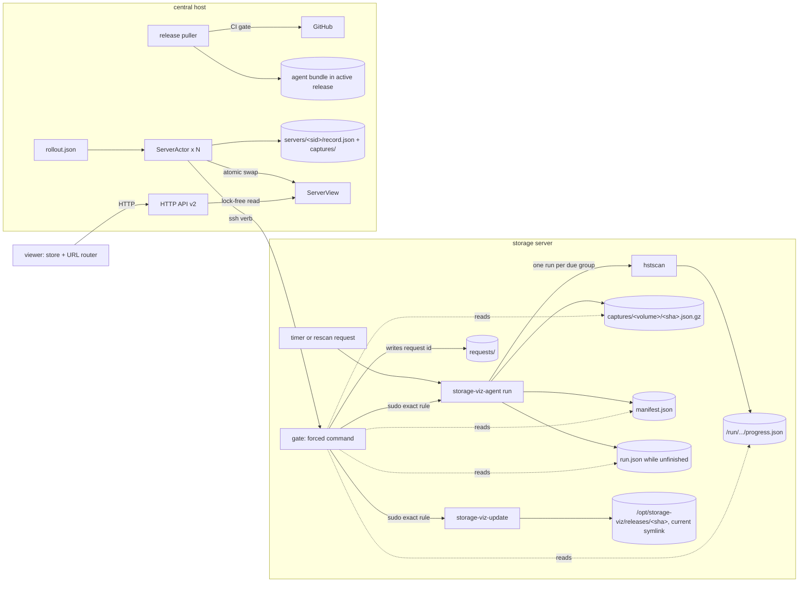
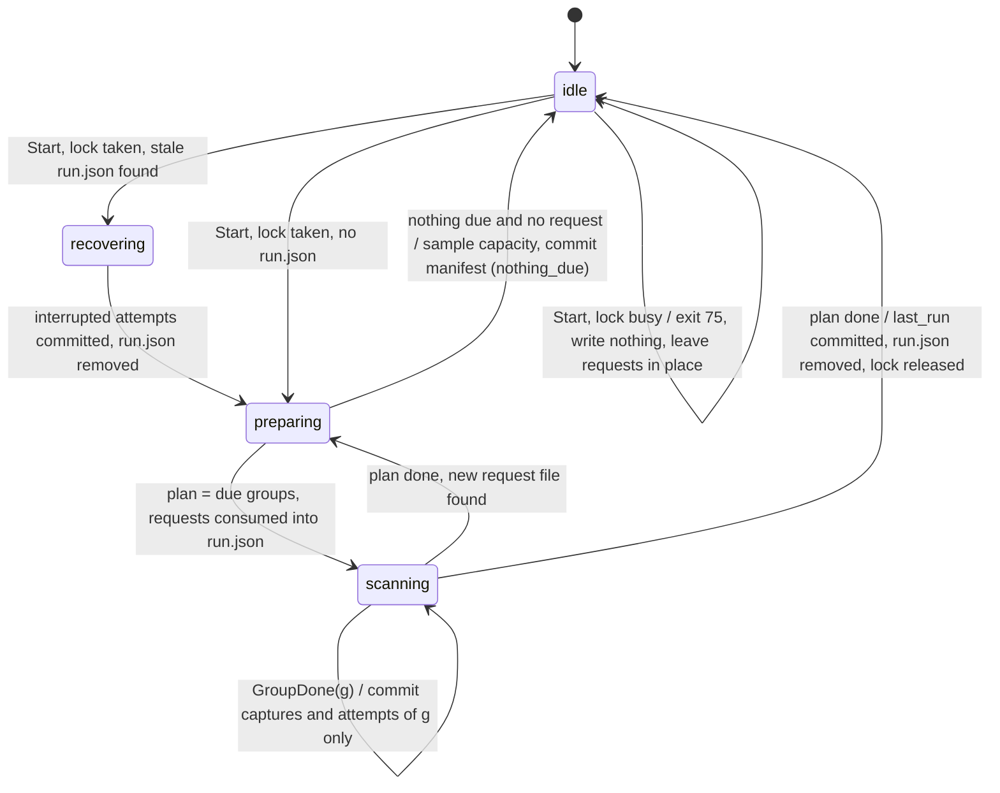
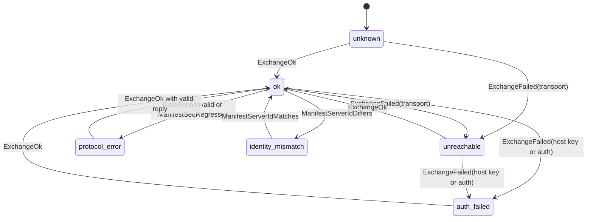
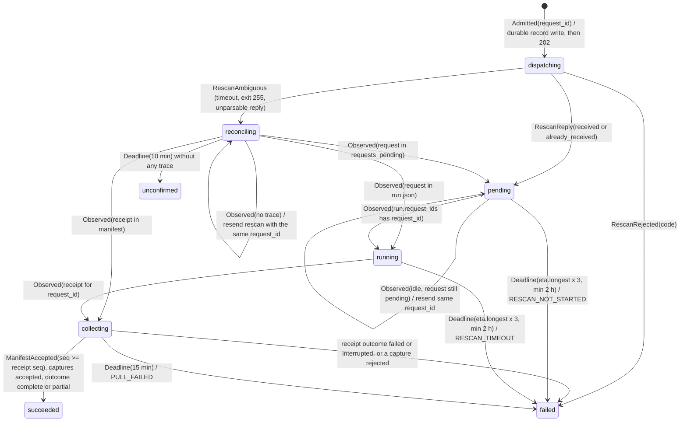
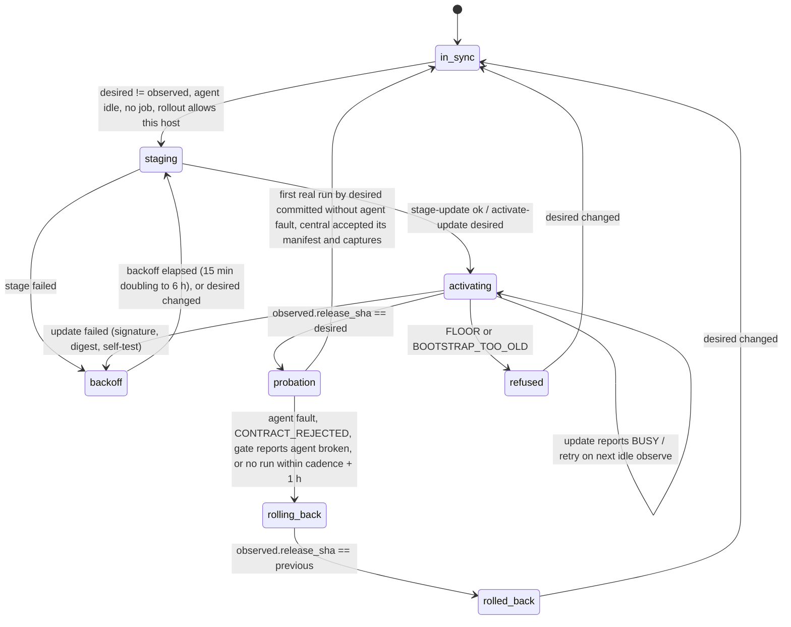
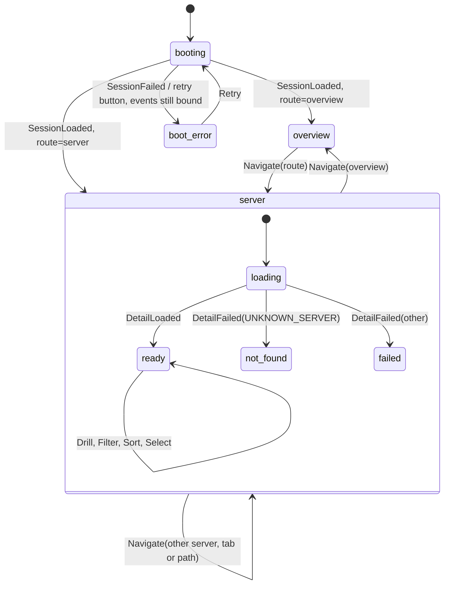

# Storage monitor: target design and migration plan

Status: final proposal for owner review. No code is written yet. Inputs: `docs/redesign/as-is.md` and `docs/redesign/bug-catalog.md` at main 06cdd5f, the arena candidates and the reference branches `fix/storage-bug-sweep` (collector and API) and `fix/storage-viewer-sweep` (viewer). Paths are relative to `apps/storage-monitor/` unless they start with `/`.

## 0. The shape in one page

Three changes remove the five structural causes. Everything else follows from them.

1. **The volume is the unit of publication.** A volume is one filesystem, identified by its UUID or by a locally provisioned alias, never by a namespace-local mount id. The agent runs one hstscan per due group, as today, so hard links across roots of one filesystem are still counted once. From each group run it publishes one immutable, content-addressed capture per volume. A small host manifest names the current capture of each volume. A failed HDD group no longer touches the SSD capture. Capacity is sampled on every tick for every volume and is never part of a capture. This removes S5 and the run-level gates behind A2, A3, A4 and A9.
2. **Each server has one owner on the central host.** A `ServerActor` thread owns one server's record, its store directory, its SSH contact and its rescan job. It changes state only through pure reducers with total transition tables. Contact results apply in issue order, by sequence number, so a late failure cannot undo a newer success. The actor publishes an immutable `ServerView` that HTTP reads without a lock. No lock is shared between servers or held across SSH. This removes S2 and most of S4 (C1 to C6, C8, C9).
3. **Every judgment lives in one place, and the viewer only renders.** Freshness, severity, used %, file age, ETA, scan activity and "newer" exist only in `collector/judge.py`. The viewer is vanilla ES modules around one store, and its route lives in the URL, so a refresh replaces data and never view state. This removes S1 and S3 (V1 to V9).

Two supporting pieces make the target reachable and keep it honest:

- **A host-side gate.** The `monitoring` key gets a forced command (`/usr/local/lib/storage-viz/gate`) with a fixed verb set. The host enforces the SSH allowlist, and the gate computes the scan state from the scan lock and `run.json`. SFTP and the Python probe that central ships today go away. A rescan carries a request id that the host records, so central confirms a job by a receipt, never by an SSH exit code.
- **A canary-first agent release channel on the dashboard release path.** CI builds and signs one agent bundle per approved SHA. The existing puller fetches it under the same CI gate. A new bundle reaches one canary host first and stays in probation until its first real scan passes. Only then do the other hosts update. A failed canary or any rollback halts the fleet through `rollout.json`. A root oneshot on each host verifies the signature and the anti-downgrade floor, self-tests the bundle, flips a symlink, and keeps the previous release for rollback.



## 1. Principles and invariants

Each invariant names the test that checks it. Test ids refer to section 5.

| Id | Invariant | How a test checks it |
|---|---|---|
| I1 | Every piece of mutable state has exactly one writer, named in §2.7. | `tools/lint_owners.py` fails on a write to an owned file or field outside its owner module. |
| I2 | Every judgment (freshness, severity, used %, age, ETA, activity, newer) has one implementation, in `collector/judge.py`. The viewer has no thresholds, cadences or clock comparisons for these. | Unit tests on `judge.py`. `tools/lint_viewer_judgments.py` fails on threshold literals and `Date.now()` in `viewer/` outside `viewer/format.js`. A view test asserts the rendered severity class equals the API `severity` field. |
| I3 | Each identity has one name and one spelling end to end: `server_id`, `volume_id`, `binding`, `capture_sha256`, `manifest_seq`, `request_id`. | Contract test runs real agent output through `collector/contract.py` and asserts the API uses only these identity keys. `tools/lint_ids.py` allows one definition of each regex and no `scan_generation`, `published_generation` or `snapshot_generation`. |
| I4 | Every HTTP request gets a status from the error table (§4.3) and one JSON envelope. No exception leaves `Handler`. | `api/test_errors.py` raises each domain error and a bare `RuntimeError` from each route. A fuzz test sends 5,000 malformed paths and requires a status line and envelope for each. |
| I5 | A failure in server A never changes the response for server B. | Corrupt A's record, hang A's SSH, make A's reducer raise. B's fleet row and detail stay byte-identical to the baseline. |
| I6 | No lock is held across a remote call, a disk commit larger than one record, or another server's work. HTTP reads take no lock. | Static: `collector/` has `threading.Lock` only in `actor.py` (inbox) and `fleet.py` (registry, admission, rollout). Dynamic: `/fleet` p99 under 20 ms while an actor commits a 512 MiB capture. |
| I7 | Link state changes only on a contact result whose `contact_seq` is newer than the last applied one. Any newer successful exchange sets `link.state = ok`. | Reducer test delivers a failure with seq 7 after a success with seq 8; link stays `ok`. |
| I8 | A capture rejected once (by sha) is never fetched again while the manifest still names it. | Actor test with a fake gate counts `get-capture` over 100 ticks: exactly 1. |
| I9 | Large data is immutable and content-addressed on host and central. After a restart, central downloads no capture it already stores. | `collector/test_store.py::test_capture_name_is_sha256`; restart test counts `get-capture`: 0. |
| I10 | A volume capture is `complete` only when no directory vanished, was replaced or was unreadable during its walk. | `scanner/test_hstscan.sh` rename and replace cases assert `outcome: partial` with a scoped error row. |
| I11 | A failure in one group never changes another group's captures. A failure on one volume never removes another volume's capture. | Runner test: SSD group succeeds, HDD hstscan exits 1. Manifest has the new SSD sha and the old HDD sha with `last_attempt.outcome = failed`. |
| I12 | The host computes scan state from two facts: `scan.lock` held, and `run.json` present. The manifest has no phase field. | `bootstrap/test_gate.py` covers the four lock/file combinations. Manifest parser rejects a `phase` key. |
| I13 | A data refresh never changes the route, drill path, filters, sorts or selection. Only a user action, or a reconcile flag on a changed entry, changes them. | `viewer/test/state.test.js` dispatches `DataLoaded` with a new revision and asserts view state deep-equal. Random-event test, I19. |
| I14 | The URL encodes the whole route. Back and forward restore it exactly. | Router property test `parse(format(r)) == r` over generated routes; browser back/forward test. |
| I15 | Only a bundle signed by the CI release key, with `release_seq >= active.rollback_floor_seq`, can activate. Activation is one atomic rename. A failed self-test leaves the previous release active. | `agent/bootstrap/test_update.py` with a tampered signature, low seq, failing self-test, and a crash between extract and rename. |
| I16 | The `monitoring` key can run only the gate verbs in §4.5. | Gate test sends every non-verb, extra argument, path token and shell metacharacter; each exits 2 with no side effect. Bootstrap test asserts `authorized_keys` has `restrict,command=`. |
| I17 | Removal commands stay copy-only with this week's behaviour (one line, no prompts, `hostname -s` check, `--one-file-system --preserve-root=all`, refusal for a mount under a selected directory, collapsed bar, typical/longest ETA). They fail closed when the mount table is unreadable, for a same-device bind mount, and for a path the encoder cannot round-trip. | `viewer/test/removal.test.js` against the pure `removal.js`, ported in M0 from `viewer_regression_test.js` and both reference branches. |
| I18 | Scanner byte counts match `du` on hard links, sparse files and deep trees. | Existing `scanner/test_hstscan.sh` parity cases, unchanged, plus a two-root hard-link case. |
| I19 | Every state machine is a total transition table. An undefined `(state, event)` pair is a test failure. Random event sequences never reach a "never" combination in §3. | Per machine: `test_<machine>_table_total` enumerates every pair; `test_<machine>_random_events` runs 10,000 seeded sequences (`random.Random(seed)` in Python, a seeded PRNG in `node:test`, no new dependency) and checks the §3 "never" list after each step. |
| I20 | Ordering uses sequence numbers and identities, never timestamps from two clocks. Ages of host timestamps are measured against host time. | `collector/test_judge.py::test_host_clock_skew` runs every derivation with a ±6 h host skew and requires the same view. |
| I21 | External bytes are parsed only at boundaries: `collector/contract.py`, `api/routes.py` request parsing, `viewer/api.js`, `agent/.../capture.py`. Nothing past them re-checks shapes. | `tools/lint_owners.py` fails on `json.loads` or `JSON.parse` outside those modules. |
| I22 | State that can be derived is not stored. `record.json` has no freshness, severity, availability or activity. | Record schema test rejects those keys. |
| I23 | A new agent sha reaches a non-canary host only after the canary has left probation on that sha. A failed canary or any host rollback halts the rollout until the desired sha changes. | `collector/test_rollout.py` table and random-event tests; nspawn end-to-end with a canary that fails probation. |
| I24 | A rescan job reaches `succeeded` only on a host receipt that carries its `request_id`. An SSH exit status alone never confirms a job. | `collector/test_jobs.py::test_exit_zero_without_receipt_is_unconfirmed`. |
| I25 | No temporary shim outlives the unit that deletes it (§6.2). | `tools/check_shims.py` fails when a `SHIM(Mx..My)` marker remains after unit My is recorded in `docs/redesign/progress.json`. |

## 2. Domain model

### 2.1 Identities

| Type | Form | Defined in | Notes |
|---|---|---|---|
| `ServerId` | `^[a-z0-9][a-z0-9-]{0,62}$` | `collector/ids.py` (the six copies are deleted) and `agent/storage_viz_agent/ids.py`, checked equal by a test | Set once in `/etc/storage-viz/agent.yaml` at bootstrap. A mismatch with the inventory gives `link.state = identity_mismatch`. |
| `VolumeId` | `v-` + 16 hex of `sha256("uuid\0" + fs_uuid)` or `sha256("alias\0" + alias)` | `agent/storage_viz_agent/identity.py` | Identifies the filesystem only. A bind alias or a second subvolume mount of the same filesystem has the same `volume_id`. Stable across reboots and mount namespaces (A2). |
| `RootBinding` | `b-` + 16 hex of `sha256(volume_id, fs_root_bytes, prune_class, config_digest, capture_schema)` | `identity.py` | Identifies what one root covers. `fs_root_bytes` is the root's path inside the filesystem: the mountinfo root field (the bind or subvolume root) joined with the path below the mountpoint. A changed bind subtree, prune class or config gives a new binding. |
| `CaptureSha` | 64 hex, sha256 of the gzip bytes on disk | agent and central | The content address. One spelling: `capture_sha256`. |
| `ManifestSeq` | integer, +1 per manifest commit | agent | The only "newer" order for host data. Compared only in `judge.is_newer`. |
| `ContactSeq` | integer, +1 per SSH exchange the actor issues | `ServerActor` | Orders contact results (I7). Persisted as `record.link.seq`. The counter resumes from it after restart. |
| `RunId` | systemd `INVOCATION_ID` of the scan unit | systemd | Correlates progress and attempts without clocks. |
| `RequestId` | 32 hex, uuid4, created by central at job admission | `collector/jobs.py` | Travels in `rescan <request_id>`. The host records it in `run.json` and in a manifest receipt. |
| `ReleaseSeq` | `git rev-list --count` of the release SHA | CI | Monotonic across agent bundles. |

**Identity sources and the ambiguity rule.** `identity.resolve(mounts)` reads each root's major:minor, resolves it through `/sys/dev/block/<maj:min>` and `/dev/disk/by-uuid`, and applies three rules in order:

1. An alias in `agent.yaml` `volume_aliases: {"/data": "pool-1"}` wins. The operator provisions it locally.
2. Otherwise a UUID that exactly one mounted device reports gives `identity: "uuid"`.
3. A missing UUID, or a UUID reported by two different devices (cloned disks, LVM snapshots), gives `identity: "ambiguous"`. The root gets a boot-local id `x-` + 16 hex of `sha256(boot_id, maj:min, mount_root)`. Ambiguous roots are never carried forward across runs, never grouped with other roots, and scanned in their own hstscan run on every timer tick. The manifest carries `diagnostic: "VOLUME_IDENTITY_AMBIGUOUS"` and the fleet shows it on the volume. The fix is an alias.

`statfs().f_fsid` is not used, because it can change after a pool re-import. The mountinfo id, `capacity_id`, major:minor as identity, the generation id with its five spellings (as-is §2.6) and the slow-capture fingerprint are deleted.

### 2.2 Host side (`/var/lib/storage-viz/`, owned by the agent)

```
/var/lib/storage-viz/
  manifest.json                         HostManifest   writer: publish.commit_manifest
  run.json                              RunRecord      writer: runner (exists only while a run is unfinished)
  captures/<volume_id>/<sha256>.json.gz VolumeCapture  writer: publish.store_capture (immutable)
  requests/<request_id>                 pending rescan writer: gate rescan; consumed by runner
  update/state.json                     UpdateState    writer: storage-viz-update
  update/incoming/<sha>.tar.gz(.sig)    staged bundle  writer: gate stage-update
/run/storage-viz/scan.lock              flock held by the runner for the whole run, and by the updater
/run/storage-viz/progress.json          Progress       writer: hstscan
```

`run.json` lives on persistent disk, so a power loss leaves it behind and the next run sees the interruption. `scan.lock` lives on tmpfs, so the kernel releases it on any exit.

**VolumeCapture** (one volume's share of one group run, gzip JSON):

```json
{
  "schema": "storage-viz.capture/2",
  "volume_id": "v-3f9a0c1d2e4b5a69",
  "run_id": "32hex", "group": "slow",
  "scan_started_unix": 1764100000, "scan_finished_unix": 1764103400,
  "outcome": "partial",
  "roots": [{
    "scan_root": "/data", "binding": "b-77c1…", "prune_class": "data", "outcome": "partial",
    "counts": {"bytes": 0, "files": 0, "dirs": 0, "errors": 1, "vanished_dirs": 1},
    "tree": {"name": "data", "kind": "dir", "bytes": 0, "files": 0, "uid": 0, "mtime": 0,
             "other_bytes": 0, "children": []},
    "users": [{"uid": 1001, "name": "kim", "bytes": 0, "files": 0}],
    "top_files": [{"path": "/data/a/b.bin", "bytes": 0, "uid": 1001, "mtime": 0}],
    "stale": [{"path": "/data/c", "kind": "dir", "bytes": 0, "uid": 1001, "mtime": 0}],
    "errors": [{"path": "/data/x", "reason": "VANISHED"}]
  }]
}
```

- A volume's `outcome` is the worst of its roots. A root is `complete` only with `errors == 0` (I10). Error reasons: `EACCES`, `VANISHED`, `REPLACED`, `FD_BUDGET_REOPEN_FAILED`, `UNREPRESENTABLE`.
- A name that is not valid UTF-8 carries `name_b64` with the raw bytes, and `name` holds the display form with U+FFFD. Rows use `path_b64` the same way. Identity uses raw bytes, so siblings never collide (A7).
- **Hard links across roots.** hstscan keeps one `(dev, ino)` set per group run, as it does today. A hard-linked inode reachable from two roots of one volume counts once in the volume. Its bytes go to the root whose walk claims the inode first, so the per-root split of shared inodes can vary between runs. The volume total equals `du -s` over all its roots together and cannot vary. Inodes never cross volumes, because each volume is a distinct `st_dev`.
- No `df_*`, no `age_days`, no `hostname` in a capture.

**HostManifest** (`manifest.json`, at most 64 KiB, atomic write with fsync):

```json
{
  "schema": "storage-viz.manifest/2",
  "server_id": "s13", "hostname": "s13", "seq": 1842, "written_unix": 1764103405,
  "agent": {"release_sha": "40hex", "release_seq": 913, "config_digest": "64hex"},
  "volumes": [{
    "volume_id": "v-3f9a0c1d2e4b5a69", "identity": "uuid", "diagnostic": null,
    "mountpoint": "/data", "fstype": "ext4", "media": "hdd", "media_confidence": "resolved",
    "group": "slow", "cadence_sec": 10800,
    "roots": [{"scan_root": "/data", "binding": "b-77c1…", "prune_class": "data"}],
    "capacity": {"total": 0, "used": 0, "avail": 0, "observed_unix": 1764103404, "status": "ok"},
    "capture": {"sha256": "64hex", "bytes": 0, "scan_started_unix": 0,
                "scan_finished_unix": 0, "outcome": "partial"},
    "last_attempt": {"run_id": "32hex", "started_unix": 0, "finished_unix": 0,
                     "outcome": "failed", "error_code": "SCANNER_FAILED"}
  }],
  "mount_table": {"status": "ok", "observed_unix": 0,
                  "within_roots": [{"mountpoint": "/data/scratch", "same_device": false},
                                   {"mountpoint": "/data/shared", "same_device": true}]},
  "last_run": {"run_id": "32hex", "trigger": "timer", "plan": "full", "started_unix": 0,
               "finished_unix": 0, "outcome": "partial", "agent_sha": "40hex"},
  "requests": [{"request_id": "32hex", "run_id": "32hex", "received_unix": 0, "outcome": "complete"}]
}
```

- `capture` is the last published capture or `null`. `last_attempt` is the last try. Keeping them apart lets a failed attempt coexist with good data (A3, A4). A volume's capture is carried forward only while every root binding still matches the current roots. A changed binding makes the volume due at once.
- `capacity` comes from a guarded `statvfs` on every tick, for every volume, including slow-only and not-due ticks (A9). The sampler checks that the mountpoint's `st_dev` still matches the volume before it attributes a sample. On failure it keeps the old sample and its old `observed_unix` and sets `status: "failed"`. It never puts a new timestamp on old values.
- `mount_table.within_roots` lists every mountinfo entry at or below a scan root, including same-device bind mounts. `status: "unreadable"` means mountinfo could not be read. The removal module refuses in that case.
- `cadence_sec` is the agent's schedule. Central freshness reads it and never copies the table (S1).
- `requests` keeps the last 16 receipts. That covers far more than the job deadline at a 900 s cooldown.
- `hostname` is `hostname -s` at publish time, for the removal host check.

**RunRecord** (`run.json`), written right after the lock is taken and removed as the last step before release:

```json
{"schema": "storage-viz.run/2", "run_id": "32hex", "trigger": "manual", "started_unix": 0,
 "request_ids": ["32hex"], "plan": [{"group": "fast", "volumes": ["v-a"]}, {"group": "slow", "volumes": ["v-b"]}],
 "current": {"group": "slow", "started_unix": 0}, "done_volumes": ["v-a"]}
```

`last_run.outcome` is one of `complete | partial | failed | nothing_due | interrupted`. No `publishing` string exists to forget (A8).

**Progress** (`/run/storage-viz/progress.json`, written by hstscan every 2 s): `{run_id, group, updated_unix, bytes, files, dirs, roots_completed, roots_total}`. The runner passes `run_id` and `group` as arguments.

### 2.3 Central store (`STATE_DIR/`)

```
STATE_DIR/
  dashboard.lock                        process singleton flock, taken once at startup
  rollout.json                          RolloutState   writer: fleet.rollout
  servers/<sid>/record.json             ServerRecord   writer: ServerActor(sid)
  servers/<sid>/captures/<sha>.json.gz  bytes exactly as fetched
```

```json
{
  "schema": "storage-viz.server-record/2",
  "server_id": "s13",
  "manifest": {"…": "last accepted HostManifest, verbatim"},
  "accepted": {"v-3f9a0c1d2e4b5a69": "64hex"},
  "rejected": {"64hex": {"volume_id": "v-…", "reason": "SHA_MISMATCH", "at": 0}},
  "link": {"state": "ok", "seq": 90211, "since": 0, "last_ok_unix": 0, "error": null},
  "job": null,
  "last_job": {"request_id": "32hex", "state": "succeeded", "…": "…"},
  "update": {"desired": "40hex", "state": "in_sync", "previous": "40hex", "attempts": 0,
             "next_try_unix": 0, "last_error": null},
  "durations": {"full": [[1764103400, 3400]], "ssd": [[1764100000, 610]]}
}
```

- Captures are stored byte for byte, so the file name is the hash. A restart lists `captures/` (C8).
- `accepted` can lag the manifest: a volume whose new capture was rejected keeps its last accepted sha and shows `data_state: stale_rejected`.
- `rejected` holds at most 32 entries, evicted when the manifest no longer names the sha (C2).
- `durations` keeps the last 5 `(finished_unix, seconds)` per plan, taken from `last_run` when its outcome is `complete` or `partial`. The keys and the rule are today's (`collector/service.py:118-126`), so the shipped ETA keeps working. M2 imports `scan-duration-history/<sid>.json` once.

**RolloutState** (`rollout.json`, one per central host):

```json
{"schema": "storage-viz.rollout/1", "desired_sha": "40hex", "release_seq": 913,
 "canary": "s13", "phase": "canary", "reason": null,
 "passed": [{"sha": "40hex", "release_seq": 912}]}
```

`phase` is `canary | fleet | halted`. `passed` keeps the last 20 shas that cleared the canary. The canary is the inventory server with `canary: true`, otherwise the lowest `order`.

### 2.4 Central memory

- `ServerActor.observation`: the last `observe` result, with the host's `now` and the central monotonic time of receipt. It is never persisted. `judge.activity` turns an observation older than `2 × observe_interval` into `unknown`. This replaces `_telemetry_cache`, which never expired.
- `ServerActor.view: ServerView`: an immutable dataclass, rebuilt after each reducer step and swapped by one attribute assignment.
- `Fleet.rollout_view`: an immutable copy of `rollout.json` that actors read.
- `LiveCapacity.samples`: unchanged (30 s GPU-collector pull).

**Host time.** `judge` measures the age of a host timestamp against `host_now = observation.now + (monotonic() - observation.received_monotonic)`. Central wall-clock time never meets a host timestamp in a comparison (I20). Before the first observation after a restart, `host_now` is `unknown`, and freshness reads `unknown` for one observe interval.

### 2.5 API shapes (v2)

`ServerSummary` (one row of `GET /api/v2/fleet`):

```json
{"server_id": "s13", "display_name": "S13", "order": 3,
 "status": "ok",
 "link": {"state": "ok", "last_ok_unix": 0, "error": null},
 "freshness": "fresh",
 "activity": {"state": "running", "run_id": "…", "trigger": "manual", "started_unix": 0,
              "progress": {"group": "slow", "roots_completed": 1, "roots_total": 2, "bytes": 0, "files": 0},
              "observed_unix": 0},
 "eta": {"typical_sec": 3400, "longest_sec": 5200},
 "job": null,
 "agent": {"release_sha": "40hex", "matches_desired": true, "update": "probation"},
 "revision": "1842:9b1c",
 "volumes": [{
   "volume_id": "v-…", "identity": "uuid", "diagnostic": null, "mountpoint": "/data", "media": "hdd",
   "capacity": {"total": 0, "used": 0, "avail": 0, "used_pct": 87, "observed_unix": 0, "source": "live"},
   "severity": "warn", "freshness": "fresh", "data_state": "current",
   "capture": {"sha256": "64hex", "outcome": "partial", "scan_finished_unix": 0},
   "last_attempt": {"outcome": "failed", "error_code": "SCANNER_FAILED", "finished_unix": 0}
 }],
 "users_top": [{"uid": 1001, "name": "kim", "bytes": 0}]}
```

A server whose view cannot be built is the row `{"server_id": "…", "status": "error", "error": {"code": "STORE_UNAVAILABLE"}}`, and the rest of the list is unaffected (C3). `revision` is `manifest_seq` plus a short hash of `accepted`. The viewer compares it only for equality.

`GET /api/v2/fleet` returns `{"generated_unix", "policy": {"capacity_thresholds": {…}}, "servers": [ServerSummary]}`. `policy` feeds the legend only.

`ServerDetail` (`GET /api/v2/servers/<id>`) is the summary plus:

- `users`: merged across volumes, `{uid, name, bytes, files, by_volume: {volume_id: {bytes, files}}}`.
- `top_files` and `stale`: merged, each row with `volume_id`, `binding` and `age_days = judge.age_days(mtime, capture.scan_started_unix)`, one reference for both tables (V5).
- `host`: `{hostname, mount_table}` for the removal command.

`VolumeCapture` (`GET /api/v2/servers/<id>/volumes/<volume_id>/captures/<sha>`) serves the stored gzip bytes with `Content-Encoding: gzip`, `ETag: "<sha>"` and `Cache-Control: private, max-age=31536000, immutable`.

### 2.6 Viewer state (`viewer/state.js`)

```js
/** @typedef {{page:"overview"} | {page:"statistics"}
 *   | {page:"server", serverId:string, tab:"treemap"|"users"|"top"|"stale",
 *      volumeId:string|null, path:string[], owner:number|null, mount:string|null}} Route */

/** @template T @typedef {{status:"idle"}|{status:"loading", requestId:number, data?:T}
 *   |{status:"ready", data:T, revision:string}|{status:"error", code:string, data?:T}} Remote */

/** @typedef {{volumeId:string, binding:string, rawPath:string[], kind:"file"|"dir",
 *   bytes:number, flag:null|"changed"|"missing"}} SelectionEntry */

/** @typedef {{
 *   route: Route,                                    // owned by router.js (mirror of the URL)
 *   session: Remote<Session>, fleet: Remote<Fleet>,
 *   details: Record<string, Remote<ServerDetail>>,   // by server_id
 *   captures: Record<string, Remote<VolumeCapture>>, // by capture sha256
 *   activity: Record<string, Activity>,              // by server_id
 *   selection: Record<string, SelectionEntry[]>,     // by server_id
 *   ui: {sorts: Record<string, SortSpec>, selectionBarExpanded: boolean, theme: string},
 *   notices: Notice[]
 * }} AppState */
```

`path` is an array of raw name segments (base64 for non-UTF-8 names), so drill identity survives any name.

### 2.7 Ownership table

| State | Single writer | Readers |
|---|---|---|
| Capture files on the host | `publish.store_capture` | gate `get-capture` |
| `manifest.json` | `publish.commit_manifest` | gate `get-manifest`, `observe` |
| `run.json` | `runner` | gate `observe` |
| `scan.lock` | the kernel, on behalf of `runner` or `storage-viz-update` | gate `observe` (through `/proc/locks`) |
| `requests/<id>` | gate `rescan` creates, `runner` consumes | runner, gate |
| `progress.json` | hstscan | gate `observe` |
| `update/state.json`, `/opt/storage-viz/current` | `storage-viz-update` | gate `observe` |
| `servers/<sid>/*` | `ServerActor(sid)` through `store.commit` | the same actor |
| `ServerActor.observation`, `.view` | `ServerActor(sid)` | HTTP (view only) |
| `rollout.json`, `Fleet.rollout_view` | `fleet.rollout` (one reducer under the fleet lock) | actors |
| Desired agent release | release puller, as `agent/` in the active dashboard release | `fleet.desired_agent()` |
| Session and CSRF | `api/auth.py` | HTTP |
| Route | `viewer/router.js` (the URL is the source) | store |
| Selection, sorts, theme | `viewer/state.js` reducer | views |
| Fetched data | `viewer/effects.js` via `DataLoaded` | views |

## 3. State machines

Every machine below is coded as `TRANSITIONS: dict[(State, EventKind), Handler]` in Python or a nested object in JS. Each pair the machine ignores has an explicit `IGNORE` entry, so no default branch exists. Each machine gets the two I19 tests: `test_<machine>_table_total` and `test_<machine>_random_events`. The shared helpers are `tests/machine_check.py` and `viewer/test/machine-check.js`. The "never" lists below are what the random-event tests assert after every step.

### 3.1 Agent scan run (`agent/storage_viz_agent/runner.py`)



- **Plan.** `plan.due_groups(manifest, roots, now, trigger, requests)` is the only cadence logic in the system. A group is a set of volumes that share one hstscan run: `fast` (resolved SSD) and `slow` (everything else), as today. All roots of one volume, bind aliases included, are always in the same group. `plan.validate_partition` checks that before launch and moves a split volume into the slower group. Each ambiguous root is a group of its own. A timer run includes a group when any of its volumes is due (`now >= capture.scan_finished_unix + cadence_sec - slack`, no capture, or a changed binding). A request makes the run `full`. The run's plan for ETA is `full` if it includes `slow`, otherwise `ssd`.
- **Requests.** At `preparing`, the runner opens each `requests/*` with `O_NOFOLLOW`, accepts only a regular file of at most 64 bytes owned by the collector group whose name and content are one request id, records the id in `run.json`, then deletes the file. A request already in `run.json` or in `manifest.requests` is deleted without effect, so a crash between record and delete cannot run a request twice. A run that loses the lock leaves request files untouched, and the running run picks them up at its end.
- **Group commit.** The manifest is committed after each group. A crash in the slow group keeps the fast group published.
- **Recovering.** A stale `run.json` means the previous run died. The runner writes `last_attempt.outcome = interrupted` for every planned volume not in `done_volumes`, `last_run.outcome = interrupted`, and a receipt with outcome `interrupted` for each request id in it. It commits the manifest and removes `run.json`. This replaces `ExecStopPost` finalize and the `boot_id` comparison.
- **Host-computed scan state** (gate `observe`, I12): lock held means `running` (with `run` from `run.json`, or `null` in the first instant of a run or during an update). No lock with `run.json` means `interrupted`. No lock and no file means `idle`. The gate finds the lock in `/proc/locks` by the lock file's device and inode, so it never takes the lock and cannot make a starting run lose it.
- Never: a manifest with a `phase`; `run.json` present while the state is `idle` after release; a commit that changes a volume outside the group just finished; a manifest whose `seq` is not previous + 1; a request id recorded by two runs.

### 3.2 Per-server health (central, `collector/health.py`)

Health has independent dimensions, each with one owner field. The fleet badge is a pure function over them, `judge.server_status`.

**Link** (stored in `record.link`). Every event carries the `contact_seq` the actor assigned when it issued the exchange. A result with `seq <= link.seq` is `IGNORE` for every state (I7, C1).



`ExchangeOk` comes from any verb: observe, manifest, capture, rescan or stage. Capture transfers run in the actor's transfer worker and can finish minutes after a newer observe. The sequence number is what keeps a late transfer timeout from marking a reachable host unreachable. `transport.classify(returncode, stderr)` maps exit codes; a host key mismatch is `auth_failed`. Never: `link.seq` decreasing; a failure with an older seq changing state.

**Data** (derived per volume, not stored):

| `data_state` | Condition |
|---|---|
| `none` | no accepted sha for the volume |
| `current` | `accepted[v]` equals the manifest capture sha |
| `fetching` | the manifest names a sha not yet in `captures/` and not rejected |
| `stale_rejected` | the manifest names a rejected sha; `accepted[v]` is served |

Events: `ManifestAccepted(m)`, `CaptureAccepted(v, sha)`, `CaptureRejected(v, sha, reason)`. A checksum mismatch gets one clean retry before it becomes a rejection, so a truncated transfer is not quarantined. Never: a sha in both `accepted` and `rejected`; a fetch of a rejected sha (I8); a manifest with lower `seq` replacing a higher one. The record is kept and `link` goes to `protocol_error` with `MANIFEST_SEQ_REGRESSED`.

**Freshness** (derived per volume by `judge.freshness(volume, host_now)`): `fresh` when `host_now - capture.scan_finished_unix <= cadence_sec + GRACE_SEC`, with `GRACE_SEC = 2 × observe_idle_interval + 360`. `stale` otherwise. `unknown` without a capture or without `host_now`. The server is the worst of its volumes. A fresh capacity sample never renews a tree.

**Activity** (memory only): `idle | running | interrupted | unknown`, copied from the host-computed state, decayed to `unknown` by age.

### 3.3 Rescan job (central, `collector/jobs.py`)



- **Idempotent dispatch.** `rescan <request_id>` is safe to repeat. The gate answers `already_received` for an id that is pending, in `run.json` or in a receipt, and it starts the unit again only when the id is pending and no run holds the lock. Resending the same id after an ambiguous reply therefore cannot cause a second scan. It also covers the narrow race where a run checks the mailbox, releases the lock, and the manual unit's start was a no-op.
- **Scheduled scan in progress.** The request waits in `requests/` and the job stays `pending`. Nothing marks it failed (C4). The running run serves it at its end.
- **Durability and admission.** `fleet.request_rescan` reserves a per-host and global slot (cooldown 900 s, 2 active jobs, both constants in `jobs.py`) under the short fleet lock, then posts `RescanRequested` to the actor. The actor writes `record.job` and replies. The API returns 202 only after that write. A failed write gives 503 `STORE_UNAVAILABLE` and releases the reservation. On restart, the fleet rebuilds reservations from the records before it opens POST admission, and non-terminal jobs resume by observation.
- `unconfirmed` is terminal. It means the host never showed a trace of the request. The UI says "not confirmed" and offers Rescan again after the cooldown.
- Never: two non-terminal jobs for one server; `succeeded` without a receipt carrying the request id (I24); a terminal job becoming non-terminal; an automatic second request id for one admitted job.

### 3.4 Agent update track and rollout (central, `record.update` and `rollout.json`)

Per host (`collector/update.py`):



An agent fault is a run outcome with an `INTERNAL_*` code, a scanner killed by a signal, or a capture or manifest that `contract.parse_*` rejects. Environment errors such as `EACCES` and `VANISHED` are scan diagnostics, not faults. `rolling_back` sends `activate-update <previous>`. The previous release is still on disk and was verified at install. The host adds the failed sha to its `bad` list and never activates it again. The canary's probation view also shows per-volume totals against the previous capture for the operator, but a totals change does not trigger rollback.

Fleet rollout (`collector/fleet.py`, `rollout.reduce`):

| Phase | Event | Next | Effect |
|---|---|---|---|
| any | `DesiredChanged(sha)`, sha in `passed` | `fleet` | Every host may stage. Used by dashboard rollback. |
| any | `DesiredChanged(sha)`, sha not in `passed` | `canary` | Only the canary may stage. |
| `canary` | `HostInSync(canary, sha)` | `fleet` | sha appended to `passed`. Others stage, at most 2 at a time. |
| `canary` | `HostFailed(canary, sha)` (rolled_back, refused, or 3 backoffs) | `halted` | `reason` set. No host stages sha. |
| `fleet` | `HostRolledBack(any, sha)` | `halted` | Hosts not yet updated stay on their release. |
| `halted` | any host event | `halted` | Waits for `DesiredChanged`. |

Never: a non-canary host staging a sha before it is in `passed` (I23); `halted` leaving without a desired change.

**Dashboard rollback and agents.** Agent rollout stays coupled to the dashboard release. The canary gate sits between the desired sha and the fleet, so it needs no second desired state. When the puller's `--rollback-state` activates an older dashboard release:

1. `fleet.desired_agent()` returns the older release's bundle, and `rollout` gets `DesiredChanged`.
2. That sha passed the canary when it was current, so it is in `passed` and the phase goes straight to `fleet`. A sha older than the 20 kept in `passed` goes through the canary again.
3. Each host on a newer bundle stages the older one. The host accepts it only if its `release_seq >= active.rollback_floor_seq`. Below the floor the host answers `FLOOR`, keeps the newer agent, and the server shows `agent.update = refused`.
4. Schema changes land reader-first: a dashboard release learns a new capture or manifest schema before any bundle emits it, and the emitting bundle's `rollback_floor_seq` is at least the reader release's seq. A dashboard rollback past that reader leaves those hosts on the newer agent. The older dashboard keeps serving the last accepted data with `link.state = protocol_error`, `SCHEMA_UNSUPPORTED`, until it rolls forward. §8 asks whether that is acceptable.

### 3.5 Viewer navigation, data and selection (`viewer/state.js`)



- Actions: `Navigate(route, {push})`, `PopState(route)`, `DataRequested(key, requestId)`, `DataLoaded(key, requestId, data)`, `DataFailed(key, requestId, code)`, `Select`, `Unselect`, `ClearSelection`, `ConfirmFlagged`, `Sort`, `ToggleSelectionBar`, `ActivityObserved`.
- `DataLoaded` with a `requestId` that is not current for its key is ignored. This one rule replaces the six "is this result still current?" schemes.
- **Selection reconcile on a new head.** After `DataLoaded(detail, new revision)`, each entry is looked up in the new captures by `(volumeId, binding, rawPath, kind)`. A full match keeps the entry and updates `bytes`. A changed binding or kind gives `flag: "changed"`. A missing path gives `flag: "missing"`. Flagged entries stay in the bar, are excluded from the command, and keep Copy disabled until the user removes them or confirms the changed ones with `ConfirmFlagged`. One notice says how many entries need review. Drill path segments that no longer exist truncate to the deepest existing ancestor. Nothing else changes (I13, V1).
- Selection is keyed by server and persists across navigation. `ClearSelection` is explicit.
- `not_found` renders only the error panel. The header, tabs and Rescan render only when `details[id].status === "ready"` (V7).
- Never: a render that reads state outside `AppState`; a route that is not in the URL; a selection entry without `volumeId` and `binding`; a flagged entry in a command; a refresh that pushes history.

## 4. Component design

### 4.1 Agent and scanner

```
agent/
  storage_viz_agent/
    __main__.py      CLI: run [--trigger timer|manual], selftest, check-config
    ids.py           ServerId, VolumeId, RootBinding, RequestId regexes
    config.py        load_config (unknown keys rejected; prune_home_mb and prune_data_mb kept)
    identity.py      resolve(mounts) -> {root: (VolumeId, identity, binding)}; ambiguity rule
    mount_policy.py  select_scan_roots (kept), plus mounts_within_roots for the mount table
    block_media.py   media classification (kept; capacity_id copy deleted)
    plan.py          due_groups(), validate_partition()   (pure)
    runner.py        the run loop of 3.1; the only writer of run.json; consumes requests/
    publish.py       store_capture(), commit_manifest(), prune(); atomic writes with fsync
    capacity.py      sample(volumes) -> guarded statvfs per volume
    capture.py       split_group_output() -> [VolumeCapture]  (boundary for scanner output)
  bootstrap/         stable tier, installed once (4.5): gate.py, update.py, units, sudoers
scanner/hstscan.c, Makefile, test_hstscan.sh
```

`scan_runner.py` (1151 lines) is deleted. `_merge_captures`, `_enrich_payload`, the slow-capture cache, `_slow_fingerprint`, `_reusable_slow_capture`, `estimate_by_plan`, `publish_lifecycle` and the "at least one complete root" gate go with it.

**Publication granularity.** One hstscan process per due group: `hstscan --run-id <id> --group <g> --out <tmp> --target <mountpoint> <maj:min> <prune_class> ...`, the argv shape of `_scanner_argv` today plus the prune class. On exit 0, `capture.split_group_output` validates the output and splits it by volume. A target that failed to open marks only its volume's `last_attempt` as failed. Then `publish.store_capture` gzips each volume capture to `captures/<v>/<sha>.json.gz` (write tmp, fsync, rename, fsync dir). `publish.commit_manifest` replaces the `capture` and `last_attempt` of that group's volumes, bumps `seq`, and writes the latest capacity samples. On a nonzero exit, only those volumes' `last_attempt` changes. Retention keeps the manifest's sha plus one previous sha per volume, so a pull that races a commit still finds its file. A pull that loses anyway gets `CAPTURE_GONE` from the gate and rereads the manifest. `prune` removes `*.tmp` older than one hour.

**Capacity.** `capacity.sample` runs at the start of every run, `nothing_due` runs included, and again before each group commit. It is separate from captures, so a reused HDD capture never carries old `df` figures (A9).

**Prune class (A6).** Each target carries an explicit prune class: `home` for `/home` and for a separately mounted home, `data` for everything else. hstscan applies `prune_home_mb` to `home` targets and `prune_data_mb` to `data` targets, after rollup, with the existing pruning algorithm. The `strcmp(tg, "/")` special case (hstscan.c:1369-1370) is deleted. The prune class is part of the root binding, so changing it forces a rescan. The no-direct-scan-of-`/` rule stays in `mount_policy`.

**Traversal robustness in hstscan (A1, A5).**

- Every directory is opened relative to its verified parent descriptor: `openat(parent_fd, name, O_RDONLY | O_DIRECTORY | O_NOFOLLOW | O_CLOEXEC)`. Symlinks are never followed. After open, `fstat` must match the `(dev, ino)` that the parent's `fstatat(..., AT_SYMLINK_NOFOLLOW)` saw, and `dev` must pass the planned device guard.
- Queued directories hold their open descriptor while the live descriptor count is under a budget (`min(1024, RLIMIT_NOFILE / 4)`). Past the budget, a queue entry stores its component vector and the observed `(dev, ino)` of every ancestor, and closes its descriptor. To resume it, hstscan reopens one component at a time from the pinned root descriptor with `openat` and `O_NOFOLLOW`, and verifies each identity.
- A child that vanished (`ENOENT`), was replaced (identity mismatch), is inaccessible (`EACCES`) or cannot be represented records a scoped error row and makes its root `partial`, counted in `errors` and `vanished_dirs`. Missing bytes are never filled from an earlier scan. A rename after a successful open is harmless, because the walk continues on the pinned descriptor and the subtree is counted. ENOENT on a regular file stays silent: the bytes are gone.
- Paths are component vectors on the heap. No fixed buffer exists, and no syscall sees a full path, so depth and length are unbounded (A5). Output paths are joined only for emission.
- Names that are not valid UTF-8 are emitted as `name_b64` plus a display `name` (A7).
- hstscan no longer reads `df`. `scanner_version` is replaced by the bundle's `release_sha`.

Sandboxing: both scan units keep today's hardening (as-is §8). `ReadWritePaths` stays `/var/lib/storage-viz /run/storage-viz`. `requests/` and `update/incoming/` are the only directories the `monitoring` group can write (`root:storage-viz-collector 0770`).

### 4.2 Collector

```
collector/
  ids.py            the one ServerId regex, parse_server_id, parse_volume_id, parse_sha, parse_request_id
  contract.py       parse_manifest, parse_capture, parse_observation, parse_update_state
  judge.py          freshness, server_status, severity, used_pct, age_days, eta, activity,
                    is_newer, host_now; every constant they use
  health.py         link and data reducers (pure, total tables)
  jobs.py           Job reducer (pure, total table)
  update.py         update-track reducer (pure, total table)
  actor.py          ServerActor: inbox thread, transfer worker, runs effects, owns store dir
  store.py          load(sid), commit(sid, record, new_capture_bytes=None), list_captures
  transport.py      run_verb(server, verb, args, stdin=None) -> bytes; classify()
  fleet.py          Fleet: actors, views(), request_rescan(), desired_agent(), rollout reducer
  inventory.py      kept; gains canary: bool; CapacityThresholds reaches judge.severity
  live_capacity.py  kept; project() moves into judge.capacity_view
  view.py           build_view(record, observation, live, now) -> ServerView   (pure)
```

Deleted: `service.py`, `scan_telemetry.py`, `duration_history.py`, `snapshot.py` (validation moves to `contract.parse_capture`), the `_mark_*` writers, `_verified_publications`, `_telemetry_cache`, `_overview_cache`, `_summary_lock`, `_DaemonWorkQueue`, `StoreLockedError`, the store flocks and `SnapshotResponseCache`.

**What the actor does each tick.**

1. `observe`, every 5 s while the agent runs or a job is active, else every 60 s. The interval comes from memory, so no disk read gates it. The result enters every reducer as `Observed`.
2. If the observed manifest sha differs from the record's: `get-manifest`, then `ManifestAccepted` or `ManifestRejected`.
3. For each volume whose manifest sha is neither stored nor rejected: hand `get-capture` to the transfer worker, with a cap of `min(manifest bytes, 512 MiB)`. The worker streams into a temp file, hashing as it goes, and posts `CaptureFetched(contact_seq, path)` or `CaptureFailed(contact_seq, class)`. `contract.parse_capture` then checks sha, schema, `volume_id`, bindings, tree sums and limits, giving `CaptureAccepted` or `CaptureRejected`. Observes keep running during a transfer.
4. Job effects (`rescan`) and update effects (`stage-update`, `activate-update`).
5. `store.commit` if the record changed, then `self.view = view.build_view(...)`.

Transfers run at most two at a time across the fleet, through one `threading.BoundedSemaphore(2)` in `fleet.py`, held around the transfer only.

**Isolation.** `ServerActor._run` wraps each tick. Any exception becomes `TickFailed(code)` and leaves `self.view` showing the last good data with `status: "error"`. A store that cannot be read at startup gives a view with `status: "error", code: "STORE_UNAVAILABLE"`. The other actors start normally. Nothing at import time touches a store.

**Persistence.** `store.commit` writes the capture file if any (tmp, fsync, rename, directory fsync), then `record.json` the same way, then removes capture files no record field names. Only the actor calls it, so no lock is needed. `dashboard.lock` prevents a second process.

**Caching.** No snapshot cache. `ServerView` holds the pre-serialized summary and the merged detail tables, built once per accepted change. The capture route streams stored gzip bytes.

### 4.3 HTTP API

`viewer/serve.py` becomes `api/`:

```
api/
  server.py     ThreadingHTTPServer; Handler.handle_request is one try around route dispatch;
                --fixtures <dir> swaps Fleet for FixtureFleet
  routes.py     ROUTES: list[(method, pattern, handler, auth)]; STATIC allowlist
  auth.py       trusted-proxy identity, session cookie, CSRF, origin checks (moved, unchanged)
  errors.py     DomainError subclasses and the STATUS table
  fixtures.py   FixtureFleet: serves a fixture directory through the same views
```

**Contract.** `/api/v2/` prefix. Responses are JSON with `Content-Type: application/json`, except the capture route. Every response carries `X-Request-Id`.

| Method and path | Auth | Success |
|---|---|---|
| `GET /api/v2/session` | read | `{authenticated, actor, can_rescan, csrf_token}` |
| `GET /api/v2/fleet` | read | `{generated_unix, policy, servers: [ServerSummary]}` |
| `GET /api/v2/servers/{sid}` | read | `ServerDetail` |
| `GET /api/v2/servers/{sid}/activity` | read | `{activity, job, last_job, eta}`, the 5 s poll target |
| `GET /api/v2/servers/{sid}/volumes/{vid}/captures/{sha}` | read | gzip bytes, immutable cache |
| `POST /api/v2/servers/{sid}/rescan` | rescan (origin, operator, session, CSRF, body `{}`) | 202 `{job}` |

**Error envelope.** Every error body is exactly `{"error": {"code": "…", "message": "…", "request_id": "…", "retry_after_sec": n}}`, with `retry_after_sec` only where the table says so. The handler writes it before any streaming begins. A truncated capture stream is detectable by `Content-Length` and the sha.

**Error-to-status table** (`api/errors.py`, the only mapping):

| Condition | Status | Code |
|---|---|---|
| No route | 404 | `NOT_FOUND` |
| Known path, wrong method | 405 + `Allow` | `METHOD_NOT_ALLOWED` |
| Bad path parameter, query or JSON body | 400 | `BAD_REQUEST` |
| Body over 1 KiB | 413 | `BODY_TOO_LARGE` |
| No trusted identity | 401 | `AUTH_REQUIRED` |
| Actor not allowed, bad origin, bad CSRF | 403 | `FORBIDDEN`, `BAD_ORIGIN`, `BAD_CSRF` |
| Server not in inventory | 404 | `UNKNOWN_SERVER` |
| Volume not in the server's view | 404 | `UNKNOWN_VOLUME` |
| Capture sha no longer retained | 410 | `CAPTURE_GONE` |
| Known server with zero accepted captures | 200 | detail with `data_state: none` and `last_attempt` diagnostics per volume |
| One host's view failed during `GET /fleet` | 200 | that row is `{"server_id", "status": "error", "error": {"code"}}` |
| Active job | 409 | `ACTIVE_JOB`, body carries the job |
| Cooldown, global limit | 429 + `Retry-After` | `COOLDOWN`, `GLOBAL_CONCURRENCY` |
| Record unreadable or not writable | 503 | `STORE_UNAVAILABLE` |
| Actor reply not within 5 s | 503 + `Retry-After: 5` | `SERVER_BUSY` |
| Any other exception | 500 | `INTERNAL`, details logged under the request id |

`UnknownServer` comes only from an inventory lookup, which runs before any store access. A store failure on a known server can never become 404 (C6). A rescan POST waits at most 5 s for the actor and always answers (C5).

**Per-server isolation.** `/fleet` joins the pre-serialized bytes of `fleet.views()`. Building one row cannot raise for another, because each view was built in its own actor (C3, C9).

**Static serving.** `routes.STATIC` maps exact URL paths to files listed in the release manifest. Any other path is 404 before the filesystem is touched. A path containing dot segments, encoded separators or malformed escapes, or one that changes under `posixpath.normpath`, is 404. `SimpleHTTPRequestHandler`, the `viewer/data` symlink, `_data_path` and the `/data/` route are deleted (C7). `debug.html`, `serve.py` and the tests are not in the allowlist.

**Fixtures mode.** `python3 -m api.server --fixtures tests/fixtures/fleet` serves a fixture fleet through the same routes, auth and views. It replaces the static `/data` demo mode. The fixtures are produced by `tools/scrub_fixture.py` from real captures: user names, uids and path components are replaced by stable synthetic values, and sizes and tree shapes are kept. Viewer unit tests, the Playwright suite and demos all run against it. Production config cannot set it: `server.py` refuses `--fixtures` when `STORAGE_VIZ_ENV=production`.

**Versioning.** The contract version is in the path. v1 routes are deleted in M8. Additive changes inside v2 need no bump. A breaking change ships as `/api/v3/` with its viewer in one release. Viewer and API ship in the same dashboard release, so they cannot disagree.

### 4.4 Viewer

No framework: native ES modules, one `<script type="module" src="main.js">`, no build step. §7 gives the reasons.

```
viewer/
  index.html
  main.js          wires store, router, effects, views; binds events once before any fetch
  store.js         createStore(reducer, init): getState, dispatch, subscribe (about 40 lines)
  state.js         AppState, actions, reducer (pure)
  router.js        parseUrl(url) -> Route, formatUrl(route) -> string (pure); popstate binding
  api.js           typed fetchers; responses parsed at this boundary
  effects.js       fetches with requestIds, an AbortController per key, polling schedules
  format.js        humanBytes, formatAge, formatTime; the only clock reader, for labels
  removal.js       pure: (selection, detail) -> {command, summary, refusal}
  columns.js       table column specs: {id, label, value(row, ctx), render(value)}
  views/           overview.js server.js header.js treemap.js users.js files.js
                   selection-bar.js scan-status.js notices.js
  styles.css
  test/            node:test suites for state, router, removal, columns; jsdom view tests;
                   layout.spec.js (Playwright, against --fixtures)
```

Deleted: `app.js`, `data-client.js`, `overview.js`, `tables.js`, `selection.js`, old `scan-status.js`, `users-chart.js`, `debug.html`, and every global.

**Store and router.** `router.js` is the only code that touches `history`. A link click is intercepted, its `href` parsed with `parseUrl`, and `Navigate(route, {push: true})` dispatched, so the card's `href` alone decides the target tab (V6). Tab, drill and filter changes push entries. `popstate` dispatches `PopState(parseUrl(location))`. URL form: `/?server=s13&tab=treemap&vol=v-3f9a…&path=data/a/b&owner=1001&mount=v-…`, with non-UTF-8 segments as `~b64~…`.

**Rendering.** Views are `render(state, root)` functions, called by one subscriber in `main.js` per state change, batched with `requestAnimationFrame`. Each view keys DOM nodes by identity (`server_id`, `volume_id`, path key) and updates them in place, so focus and scroll survive. The treemap keeps its ECharts instance and calls `setOption` with the capture for `route.volumeId` and the drill path from `route.path`.

**Tables.** Users, Top files and Stale render from `columns.js`. Sort uses the same `value(row, ctx)` the cell renders, where `ctx` carries the active filters. A filtered-out value renders `—` and sorts last (V9). Each table is one scroll region: the header is a `position: sticky` row of the same CSS grid inside the viewport, so columns cannot drift (V4). Path has a readable minimum width (240 px at phone width, the value the viewer branch verified). The Select track is `minmax(5.5rem, max-content)`, so the button keeps its intrinsic width (V3). Horizontal overflow belongs to the table region, never the page.

**Refresh semantics.**

- `fleet`: every 60 s while visible, and on focus.
- `details[sid]`: when the fleet row's `revision` differs from the held one, and on focus.
- `captures[sha]`: once per sha, never again.
- `activity[sid]`: every 5 s while the server page is open and activity is `running` or a job is active.
- A focus refresh is the same as any refresh. By I13 it changes only data and runs the selection reconcile.

**Removal command.** `removal.js` keeps this week's behaviour from `selection.js`: one line, `if [ "$(hostname -s)" = '<host>' ]; then … fi`, `sudo rm -rf --one-file-system --preserve-root=all --` for directories and `sudo rm -f --` for files, every argument single-quoted, end of options, and the nested-pick summary from `cleanupEffectiveEntries`. Before it emits anything it checks every selected directory and refuses with a reason when:

- any `mount_table.within_roots` entry lies at or below a selected directory (`same_device: true` included, because `--one-file-system` does not stop at a same-device bind mount);
- `mount_table.status` is `unreadable`;
- any selected path cannot be encoded so that it round-trips byte for byte (control characters, or bytes the single-quote encoder cannot carry), and such paths cannot be picked at all;
- any entry is flagged.

The host is `detail.host.hostname`. The ETA label shows `eta.typical_sec`, and switches to `eta.longest_sec` once elapsed time passes typical, counting from server time plus monotonic time since receipt. The selection bar starts collapsed. Copy to clipboard is the only side effect.

### 4.5 Host gate and agent update channel

**Two tiers on the host.**

| Tier | Contents | Location | Updated by |
|---|---|---|---|
| bootstrap | `gate.py`, `update.py`, systemd units, sudoers, release public key, `agent.yaml` | `/usr/local/lib/storage-viz/`, `/etc/systemd/system/`, `/etc/sudoers.d/storage-viz`, `/etc/storage-viz/` | `deploy/bootstrap-agent.sh`, run by an operator once per host and again only when `bootstrap_version` changes |
| release | `storage_viz_agent/`, `bin/hstscan`, `bin/storage-viz-agent`, `RELEASE-MANIFEST.json` | `/opt/storage-viz/releases/<sha>/`, `/opt/storage-viz/current` | the update channel |

The bootstrap tier is small (gate about 180 lines, updater about 250) and owns rollback, so a broken release cannot break the path that replaces it.

**Gate verbs.** `authorized_keys` for `monitoring`: `restrict,command="/usr/local/lib/storage-viz/gate" ssh-ed25519 …`. The gate reads `SSH_ORIGINAL_COMMAND`, splits on spaces and accepts exactly:

| Verb | Arguments | Effect | Output cap |
|---|---|---|---|
| `observe` | none | one JSON: host-computed `scan {state, run}`, `requests_pending`, manifest `{seq, sha256}`, progress, `ActiveState` and `InvocationID` of the scan, scheduled-scan and update units, update state, agent health (`broken` when the release's `storage-viz-agent check-config` fails), `boot_id`, `now` | 64 KiB |
| `get-manifest` | none | bytes of `manifest.json` | 64 KiB |
| `get-capture` | `<volume_id> <sha256>` (regex-checked, opened by digest under a fixed directory) | bytes, or `CAPTURE_GONE` | 512 MiB |
| `rescan` | `<request_id>` (32 hex) | writes `requests/<id>` unless already known, then `sudo -n systemctl start --no-block storage-viz-scan.service` unless a run holds the lock; prints `received`, `already_received` or `rejected <code>` | 1 KiB |
| `stage-update` | `<sha40> <size>` | reads exactly `size` bytes (cap 64 MiB) from stdin into `update/incoming/`, then a detached signature of at most 4 KiB | 1 KiB |
| `activate-update` | `<sha40>` | writes the target sha to `update/incoming/activate`, then `sudo -n systemctl start --no-block storage-viz-agent-update.service` | 1 KiB |

Anything else exits 2. SFTP, the remote Python probe and `sftp-server` as a dependency are removed.

**Sudoers** (`/etc/sudoers.d/storage-viz`, two exact rules):

```
monitoring ALL=(root) NOPASSWD: /usr/bin/systemctl start --no-block storage-viz-scan.service
monitoring ALL=(root) NOPASSWD: /usr/bin/systemctl start --no-block storage-viz-agent-update.service
```

`--no-block` replaces the 6 h blocking `start`, so no central thread waits on a scan.

**Build.** The `ci/storage` job, on a push to `main` that touches `agent/` or `scanner/`, runs `deploy/build-agent-release.py --sha <sha>`. It compiles hstscan in a pinned container with the oldest glibc in the fleet (§8). It packs the release tier with `RELEASE-MANIFEST.json` `{application: "storage-viz-agent", source_sha, release_seq, rollback_floor_seq, bootstrap_version, files: {path: sha256}}` and signs the archive with `ssh-keygen -Y sign -n storage-viz-agent`. The private key is a GitHub environment secret available only to `main`, so central never holds it. `ssh-keygen -Y verify` is already on every host. `rollback_floor_seq` is the `release_seq` of the oldest release that may still be rolled back to. It normally trails by 20 and is raised past a schema reader boundary (§3.4).

**Gate on central.** `storage-monitor-release-puller.py` gains one step after `authorize`. `fetch_agent_artifact(config, sha)` downloads the CI artifact for the same SHA through the same `fetch_evidence` and `authorize` checks, verifies the signature with the key the hosts pin, and places it at `storage-monitor/agent/storage-viz-agent-<sha>.tar.gz{,.sig}`. `storage_dashboard_release.REQUIRED_RELEASE_FILES` adds these two paths. Activation, health check, idempotence, backoff and `--rollback-state` are reused unchanged. The desired agent release is the bundle inside the active dashboard release. `rollout.json` only decides which hosts may move to it.

**Delivery and activation.** Each actor runs the §3.4 update track: it stages when `rollout_view` allows its host, then activates. `storage-viz-update` (root oneshot, bootstrap tier):

1. Take `/run/storage-viz/scan.lock` without waiting. If busy, write `BUSY` and exit 75, so an update never interrupts a scan.
2. Read the target sha from `update/incoming/activate`. If it is an installed release, re-check its files against its recorded manifest digests and go to step 5. Otherwise verify the signature against `/etc/storage-viz/release-signing.pub`, the archive digest, `release_seq >= active.rollback_floor_seq` and `bootstrap_version <= installed`. Refuse a sha in `bad`. A failure writes `last_attempt` with a code and exits.
3. Extract to `/opt/storage-viz/releases/<sha>.tmp/` (root:root, 0755, regular files only, no setuid, no links, no absolute or `..` paths), check every file against the manifest digests, and rename to `<sha>/`.
4. Run `releases/<sha>/bin/storage-viz-agent selftest` under the scan unit's sandbox (`systemd-run --pipe` with the same properties). It imports the package, parses `agent.yaml`, and scans a generated tree in a tmpfs with hstscan, comparing totals to known values.
5. Point `current.new` at the release and `rename` it over `current`, then fsync the parent. Write `update/state.json` `{active, previous, bad, last_attempt}`. Keep three releases.
6. On self-test failure, leave `current` unchanged and add the sha to `bad`.

Each step reads state from disk, so a rerun after a crash converges. Unit: `ProtectSystem=strict`, `ReadWritePaths=/opt/storage-viz /var/lib/storage-viz/update /run/storage-viz`, `PrivateNetwork=yes`, `RestrictAddressFamilies=AF_UNIX`, `NoNewPrivileges=yes`, `CapabilityBoundingSet=CAP_CHOWN CAP_FOWNER`.

**Trust.** Central can deliver only CI-signed bundles, and hosts refuse those below the floor. A compromised central host can trigger scans, offer an already-signed release and read scan data. It cannot run code as root on a host.

**One-time bootstrap** (`deploy/bootstrap-agent.sh <host>`, replaces `install-agent.sh` and `deploy-agent.sh`). It needs an admin account with sudo, once. On the host it:

1. creates `monitoring` if missing and writes its `authorized_keys` with the forced command;
2. creates the `storage-viz-collector` group and the directories with today's modes, plus `requests/` and `update/incoming/`;
3. installs the bootstrap tier, the public key and the units, then runs `visudo -cf` and `systemd-analyze verify` (both required);
4. writes `/etc/storage-viz/agent.yaml` from the old `scanner.yaml`, keeping `server_id` and the prune settings, and prints the identity resolution so the operator can add `volume_aliases` for ambiguous roots;
5. stages the bundle from the active dashboard release and runs the updater locally;
6. backs up what it replaced for `--revert`, enables the timer and prints `observe` output.

Host requirements become python3, systemd, sudo and OpenSSH 8.1 or later. `cc`, `make` and `sftp-server` are no longer needed.

**As built in M3a (2026-11-27).** These points differ from the text above:

- The pinned key is `/etc/storage-viz/allowed_signers` (ssh-keygen allowed_signers format, principal `storage-viz-release`), not `release-signing.pub`. Central pins the same file at `/etc/storage-viz/agent-allowed-signers`.
- Every gate reply starts with `storage-viz-gate/<bootstrap_version> ok <bytes>` or `... err <CODE>`, so central tells refusals from data and detects a short body.
- A seventh verb, `rollback-update <sha40>`, is the bad-run signal. It re-activates the recorded `previous` release and adds the active one to `bad`. `activate-update <previous>` stays a plain activation, so a dashboard rollback never marks a release bad. The update request file holds `activate <sha>` or `rollback <sha>`.
- The updater self-tests from `releases/<sha>.tmp` and renames only after a pass, so a crash never leaves an unverified release that looks installed. The floor and bootstrap checks also apply to installed releases.
- `requests/` and `update/incoming/` are setgid (`2770`). The update unit has no `CAP_DAC_OVERRIDE`, so it can read the gate's files only through the collector group. The update unit has the scan units' `RuntimeDirectory` and group, so an update never takes the gate's read access to `scan.lock` away.
- Signing runs in `.github/workflows/agent-bundle.yml` (workflow_run after `ci` on main), not in `ci.yml`, because the workflow policy forbids secrets in any workflow that pull requests trigger. `ci.yml` builds the same bundle unsigned. The artifact is `viz-agent-bundle-<sha>`.
- The bundle's `source_sha` is the newest commit that changed an agent input, so commits without agent changes reuse the bundle. `rollback_floor_seq` trails 20 agent releases and is raised by `agent/RELEASE-FLOOR.json`.
- The dashboard release carries the bundle at fixed paths, `agent/storage-viz-agent.tar.gz{,.sig}` plus `agent/storage-viz-agent.json` (sha, seq, digest, size). Only the puller requires them, so manual dashboard builds still work. Downloading the artifact needs a read-only GitHub token at `/etc/storage-viz/github-token`.

**Limits found in M4 (accepted 2026-11-27).** Row paths in `top_files`, `stale` and error rows are capped at 4096 bytes, because the agent and collector reject longer strings. Longer rows are skipped from those lists, but their bytes still count in totals. An error row deeper than that is reported at its deepest ancestor that fits. Tree depth is capped at 128 levels by folding deeper levels into `other_bytes` at the cap (A10, fixed in M5). `vanished_dirs` counts VANISHED, REPLACED and FD_BUDGET_REOPEN_FAILED rows, not EACCES.

## 5. Bug coverage

Test paths are under `apps/storage-monitor/`. Every test lands in M0 as a strict expected failure named after its bug id and flips to passing in the named unit. The reference-branch column names the source of the regression case: the hunt repro for every id, plus the viewer branch's test for V1 to V9. `tools/check_bug_coverage.py` parses the ids from `bug-catalog.md` and fails CI if an id has no test citing it.

| Bug | Design element that makes it impossible or caught | Test | Unit |
|---|---|---|---|
| C1 | One `link` dimension. Contact results apply by `contact_seq`, and any newer success sets `ok` (I7). | `collector/test_health.py::test_c1_observe_success_clears_unreachable`, `::test_c1_late_failure_ignored` | M2 |
| C2 | `record.rejected` keyed by sha. A rejected sha is never fetched again (I8). | `collector/test_actor.py::test_c2_rejected_capture_fetched_once` (100 ticks plus restart) | M2 |
| C3 | `/fleet` joins per-actor views. A broken server is a typed error row in a 200 (I5). | `api/test_routes.py::test_c3_fleet_isolates_unreadable_server` | M2 |
| C4 | The request waits in `requests/` while a scheduled scan runs. The job stays `pending`. No check-then-act across threads. | `collector/test_jobs.py::test_c4_scheduled_scan_during_request_stays_pending`; `agent/test_runner.py::test_c4_request_served_after_running_scan` | M2 (reducer), M5 (host) |
| C5 | Rescan goes through the actor inbox with a 5 s bound and a top-level handler try (I4). | `api/test_routes.py::test_c5_rescan_always_answers_when_actor_busy` | M2 |
| C6 | `UnknownServer` comes only from the inventory lookup. Store errors are 503. | `api/test_errors.py::test_c6_store_error_on_known_server_is_503` | M2 |
| C7 | The `/data` read check (M1), then an exact static allowlist after normalization, with the symlink and `/data` deleted. | `api/test_static.py::test_c7_traversal_variants_404` (the 3 repro URLs, HEAD, directory form and a fuzz list) | M1, M6 |
| C8 | Captures stored byte-exact and named by sha. A restart lists them (I9). | `collector/test_actor.py::test_c8_restart_downloads_nothing` | M2 |
| C9 | No shared lock. Views swap atomically, and `/fleet` reads bytes (I6). | `api/test_latency.py::test_c9_fleet_p99_during_large_commit` | M2 |
| V1 | URL-held route plus store. `DataLoaded` keeps view state and reconciles selection (I13). | `viewer/test/state.test.js::v1 refresh keeps drill, filters and selection`; `viewer/test/layout.spec.js::v1 focus keeps removal list` | M7 |
| V2 | Severity computed once in `judge.severity` from inventory thresholds. The viewer renders the field (I2). | `collector/test_judge.py::test_v2_severity_thresholds`; `viewer/test/views.test.js::v2 severity class equals api field` | M2 (API), M7 (viewer) |
| V3 | Select track `minmax(5.5rem, max-content)` in the shared grid. | `viewer/test/layout.spec.js::v3 select button hit test`: at 390, 768 and 1440 px, scroll the Stale region to Select, `elementFromPoint` at the button's four inset corners returns the button, and a click raises the pick count by 1 | M7 |
| V4 | Sticky header inside the scroll region, same grid. | `viewer/test/layout.spec.js::v4 header aligned after scroll`: header and body cell rectangles match after a horizontal scroll at 390 px, Path at least 240 px, no page overflow | M7 |
| V5 | `age_days` computed once against the capture's scan start, for both tables. | `collector/test_judge.py::test_v5_age_same_reference` with browser and host clocks on different days | M2 |
| V6 | The router navigates by parsing the clicked `href`. | `viewer/test/router.test.js::v6 card href decides tab` | M7 |
| V7 | The shell renders only for a `ready` detail. `not_found` renders the error panel only. | `viewer/test/views.test.js::v7 unknown server shows only not-found panel` (direct load and via history) | M7 |
| V8 | Owner and mount filters live in the URL. Popstate restores them (I14). | `viewer/test/router.test.js::v8 round trip`; `viewer/test/layout.spec.js::v8 back forward keeps owner filter` | M7 |
| V9 | Column spec: sort uses the rendered `value`. | `viewer/test/columns.test.js::v9 files sort uses filtered value` (fixture inverts filtered and unfiltered order) | M7 |
| A1 | Descriptor-relative walk on pinned descriptors with identity checks. A vanished or replaced child is a scoped error and makes the root partial (I10). | `scanner/test_hstscan.sh` cases `a1_rename_during_scan` and `a1_replace_during_scan`, using the pause hook `HSTSCAN_TEST_PAUSE_AFTER_ENUM`: totals include the pinned subtree, or the root is partial with a `VANISHED` or `REPLACED` row | M4 |
| A2 | `volume_id` from the filesystem UUID or alias. Carry-forward keyed by binding. Mountinfo ids never persisted. | `agent/test_identity.py::test_a2_same_id_across_mount_namespaces` (`unshare -m` in CI); `::test_a2_changed_bind_root_forces_rescan`; `::test_a2_duplicate_uuid_is_ambiguous` | M5 |
| A3 | Per-volume publication. Partial and failed attempts never block the manifest. | `agent/test_runner.py::test_a3_single_partial_volume_publishes`; `::test_a3_all_failed_records_attempts` | M5 |
| A4 | Group and volume isolation in the manifest (I11). | `agent/test_runner.py::test_a4_hdd_failure_keeps_ssd_capture` | M5 |
| A5 | Component vectors, relative opens, FD budget with verified reopen. | `scanner/test_hstscan.sh` case `a5_path_over_4096` checks totals against `du` under `ulimit -n 64` | M4 |
| A6 | An explicit prune class per target. `prune_home_mb` applies to `home` targets, including a separately mounted home. | `scanner/test_hstscan.sh` case `a6_prune_class`: same-size home and data trees, different thresholds, no `/` target; emitted children differ by class and rollup bytes are preserved. `agent/test_runner.py::test_a6_home_mount_gets_home_class` | M4 |
| A7 | `name_b64` for non-UTF-8 names. Identity on raw bytes. Unencodable paths cannot be picked. | `scanner/test_hstscan.sh` case `a7_non_utf8_siblings_distinct`; `viewer/test/state.test.js::a7 drill into b64 segment`; `viewer/test/removal.test.js::a7 unencodable path not selectable` | M4, M7 |
| A8 | No phase in the manifest. Scan state is host-computed from the lock and `run.json` (I12). | `agent/test_runner.py::test_a8_no_run_json_after_completion`; `bootstrap/test_gate.py::test_a8_crash_reports_interrupted` | M5 |
| A9 | Capacity sampled on every tick, separate from captures. | `agent/test_runner.py::test_a9_capacity_fresh_on_slow_only_not_due_tick`: mocked `statvfs` changes; old tree sha and time appear with new capacity and time | M5 |

Shipped behaviour of this week (#11 to #15) is covered by `viewer/test/removal.test.js` (command form, host check, flags, mount refusal, nested-pick summary), `viewer/test/views.test.js::selection bar starts collapsed` and `collector/test_judge.py::test_eta_typical_then_longest`. All are green from M0 and stay green in every unit.

## 6. Migration plan

### 6.1 Units

**Delivery (owner decision, 2026-11-26).** Units land on the integration branch `redesign/storage-monitor`, not on `main`, and nothing deploys until every unit is done and verified. Then one release goes out: the dashboard through the puller, then the canary host bootstrap and the fleet rollout. Each unit still ends CI-green on the integration branch with its own harness, so the sequence proves itself before the single deploy.

Rules for every unit: it lands as one commit series, or as the named a/b series. It is CI-green on the integration branch. Its test harness exists before the change. It names what it deletes. Dashboard units roll back with the puller's `--rollback-state`. Agent units roll back by dashboard rollback, which moves the desired agent back (§3.4).

**Order.** Riskiest first where dependencies allow. The riskiest work is on hosts (M3 channel, then M5 format), then the central rewrite (M2). M2 comes before M3 only because the actor is what stages bundles; staging from the old service would be thrown away. M1 carries one exception: the three-line C7 read check, a security fix too small to wait. The low-risk HTTP and viewer units come last. The verified fixes from the two reference branches are folded in, not merged alone. Each unit that replaces a bug's code path uses the branch diff as its oracle, and its tests as acceptance.

#### M0. Harness

- Changes: port the 27 hunt repros as tests named after their bug ids, each `xfail(strict=True)` in Python or an expected-failure wrapper in `node:test` that fails if the test passes. Port the 8 regression tests of `fix/storage-viewer-sweep` the same way. `fix/storage-bug-sweep` has no tests of its own, so its cases are the hunt repros for C1 to C7. Add `tools/check_bug_coverage.py`, `tools/check_shims.py`, `tests/machine_check.py` and `viewer/test/machine-check.js`. Port the removal and ETA cases from `viewer_regression_test.js` to `viewer/test/removal.test.js` against the pure functions of `selection.js`, exported through `globalThis` (shim S1). Add a Playwright smoke against `serve.py` with a fixture inventory: load overview, open a server, drill, select, copy the command.
- Harness: CI green, and each expected failure fails for the catalog's reason (asserted message, not just failure).
- Rollback: revert the PR. No runtime change.
- Deletes: nothing.

#### M1. Subtract dead weight

- Changes: delete `users-chart.js` and its tests, `store.apply_download`, the `requested` job state, `not_installed`, the persisted `freshness` field (tolerated on read), `detailCapacityPercent`, `treemapInited`, `currentOverviewRows`, the documented but unemitted `df_observed_unix`, and the duplicate `REMOTE_FSTYPES` in `collector/service.py`. Collapse the six `SERVER_ID_RE` copies into `collector/ids.py`. Apply the `/data` read-check hunk from `fix/storage-bug-sweep` (`viewer/serve.py`).
- Harness: existing suites; C7 repro flips.
- Rollback: puller rollback.
- Deletes: the files and fields above.

#### M2. Server actors and one judge (C1, C2, C3, C4 reducer, C5, C6, C8, C9; V2 and V5 fields)

- M2a: add `collector/judge.py` (`freshness`, `severity`, `used_pct`, `age_days`, `eta` with the shipped `estimate_range` rule, `activity`, `host_now`) and `contract.py`. Point the old service at `judge`, delete its five freshness computations, and add `severity`, `used_pct` and `age_days` to the v1 responses (additive).
- M2b: add `health.py`, `jobs.py`, `update.py` (inactive until M3), `actor.py`, `fleet.py`, `view.py`, the new `store.py` under `STATE_DIR/servers/`, and `api/errors.py` with the top-level try. The actor speaks today's protocol through a legacy adapter (S2): SFTP status and snapshot, the Python probe, and blocking `systemctl start` in a helper thread that posts to the inbox. A v1 snapshot is read as one pseudo-volume `legacy` (S3). A v1 job has no receipts, so it correlates by the scan unit's `InvocationID` and ends `unconfirmed` when ambiguous (S4). v1 routes read `ServerView` (S5). The actor imports `scan-duration-history/<sid>.json` once (S6), so the ETA keeps its history.
- Harness: the transition-table and random-event tests for link, data, job and update land with their reducers. The C1, C2, C3, C5, C6, C8, C9, V2 and V5 tests flip, and the C4 reducer test flips. Ported `test_service.py` behaviour cases (unchanged-generation skip, keep last good on failure, transfer limits) pass against the actor with a fake transport.
- Rollback: puller rollback. M2 leaves the old store under `STATE_DIR/<sid>/` untouched and readable by the previous release (retained data R1). The new store starts empty and re-pulls each snapshot once (§8).
- Deletes: `service.py`, `scan_telemetry.py`, `duration_history.py`, the old `store.py`, `_mark_*`, all caches and locks listed in 4.2, `SnapshotResponseCache`.

#### M3. Bootstrap tier, gate and canary-first channel

- Changes: add `agent/bootstrap/` (gate, updater, units, sudoers), `deploy/build-agent-release.py`, the CI signing step, `fetch_agent_artifact` in the puller, `deploy/bootstrap-agent.sh`, `rollout.json` and the rollout reducer, and the gate transport in `collector/transport.py`. The first bundle is today's agent code unchanged (`scan_runner.py` and hstscan), so this unit tests the channel alone. The agent still writes v1 files, so the gate also serves `get-snapshot <generation>` and `get-status` (S7). `rescan <request_id>` writes the mailbox and starts the unit, but the v1 runner writes no receipts, so jobs keep S4 until M5. A host uses the gate transport once its bootstrap is done. Until then, the S2 legacy adapter serves it.
- Harness, before rollout: gate and updater unit tests (I15, I16), rollout table and random-event tests (I23), and an end-to-end test in CI. It boots a `systemd-nspawn` container with sshd, runs `bootstrap-agent.sh` against it, stages and activates a bundle, stages a tampered one (refused), a self-test-failing one (not activated), and one that fails probation (rolled back, rollout halted).
- Rollout: bootstrap the canary host. Push a no-op release and watch it pass probation. Force a rollback drill. Then bootstrap the rest.
- M3b, once every host reports the gate transport: delete S2.
- Rollback: per host, `bootstrap-agent.sh --revert` restores the backed-up `authorized_keys`, sudoers, units and the old `/opt/storage-viz` copy. Central rolls back with the puller.
- Deletes: `install-agent.sh`, `deploy-agent.sh`, `REMOTE_OBSERVATION_SCRIPT`, the per-host `cc` build; in M3b the SFTP code.

#### M4. Scanner traversal and prune class (A1, A5, A6, A7)

- Changes: the descriptor-relative walk with the FD budget, component-vector paths, scoped error rows, `name_b64`, and the explicit prune class per target (runner passes it, hstscan applies it). This is the first real update through the channel, and it exercises canary and probation on a contained change. The v1 snapshot gains additive fields only (`name_b64`, error reasons), which the M2 contract accepts.
- Harness: A1, A5, A6 and A7 scanner cases, plus the existing du parity, sparse, hard-link and deep-tree cases, against both the old and the new binary. Low-FD runs (`ulimit -n 64`).
- Rollback: dashboard rollback. The previous bundle is in `passed`, so hosts return to it.
- Deletes: the fixed path buffer, reopen-by-path, the `strcmp(tg, "/")` prune special case.

#### M5. Per-volume publication from group runs (A2, A3, A4, A8, A9, A10; C4 host side)

- Changes, central first (M5a): `contract.parse_manifest`, per-volume captures and receipt-based jobs in the actor. A host whose `observe` shows no `manifest.json` stays on S3 and S4.
- Changes, agent (M5b): the `storage_viz_agent` package replaces `scan_runner.py`, delivered by the channel through the canary. The new agent leaves the v1 files in place (S8), so a rollback finds them.
- M5c, once the fleet view shows every host on v2: delete S3, S4, the central callers of S7 and S8 (the new agent prunes `snapshots/`, `scan-status.json`, `scan-lifecycle.json` and `slow-capture.json.gz`), and `collector/snapshot.py`.
- Harness: the A2, A3, A4, A8, A9 and C4 host tests flip. The scan-run table and random-event tests land. A contract test parses real output from the nspawn host. The canary's per-volume totals equal the v1 snapshot's per-mount totals. A kill test stops the runner after each persist step and checks recovery.
- Rollback: before M5c, dashboard rollback to the M4 release. The old agent and the S3 path resume on the retained v1 files. After M5c, roll back to M5b's release.
- Deletes: `scan_runner.py` and everything listed in 4.1; in M5c the shims above.

#### M6. HTTP edge: static allowlist and fixtures mode (C7 structural)

- Changes: split `viewer/serve.py` into `api/` (4.3), with the exact static allowlist, the full error table, the envelope, `--fixtures` and `tools/scrub_fixture.py`. Point the Playwright smoke at `--fixtures`.
- Harness: C7 traversal fuzz, I4 fault injection over every route, `test_serve.py` auth cases moved to `api/test_auth.py`.
- Rollback: puller rollback.
- Deletes: `SimpleHTTPRequestHandler`, the `viewer/data` symlink, `_data_path`, the `/data/` route, the tracked `data/*.sample.json` demo mode, static `debug.html`.

#### M7. Viewer store and router on v1 (V1, V3, V4, V6, V7, V8, V9; V2 and V5 rendering)

- Changes: replace the classic scripts with the ES module layout in 4.4, reading the v1 routes, which carry the judged fields since M2. First port the remaining `viewer_regression_test.js` cases to behaviour tests, in a separate PR inside the unit, then switch. The selection reconcile follows the viewer branch's `retainCleanupSelection`, tightened to binding, path and kind.
- Harness: the V tests flip, including the V3 hit test and the V4 geometry test in a real browser against `--fixtures`. The viewer table and random-event tests land. Removal and ETA tests from M0 pass unchanged.
- Rollback: puller rollback.
- Deletes: `app.js`, `data-client.js`, `overview.js`, `tables.js`, `selection.js` with S1, old `scan-status.js`, `viewer_regression_test.js`, `viewer.test.js`, `debug.html`.

#### M8. API v2

- Changes: add the v2 routes and the per-volume capture route. Switch `viewer/api.js` and the treemap to per-volume captures in the same PR.
- Harness: v2 contract tests, the Playwright suite, I4 fault injection over v2.
- Rollback: puller rollback. Viewer and API move together.
- Deletes: every v1 route and its builders (S5), `live_capacity.project`, the `data_mode` duplication.

#### M9. Close out

- Changes: delete the old `STATE_DIR/<sid>/` store and the imported duration history (R1, S6) after one week on M2, with a one-shot script the operator runs. It is the only data deletion in the plan. Ship `bootstrap_version 2` without S7 and rerun `bootstrap-agent.sh` on each host, one command per host. Update `docs/architecture.md` and `docs/operations.md`, and replace `docs/schema-v1.md` with `docs/schema-v2.md`.
- Harness: `check_bug_coverage.py` green with no expected-failure markers left; `check_shims.py` finds no markers; `lint_owners.py`, `lint_ids.py` and `lint_viewer_judgments.py` over the whole tree.
- Rollback: the store deletion is not reversible, so it runs only after the week. The bootstrap rerun reverts per host with `--revert`.

### 6.2 Temporary shims

Every shim carries a `SHIM(Mx..My)` marker that `tools/check_shims.py` checks (I25).

| Id | Shim | Added | Deleted |
|---|---|---|---|
| S1 | `selection.js` pure functions exported through `globalThis` for removal tests | M0 | M7 |
| S2 | Legacy transport adapter in the actor (SFTP, Python probe, blocking `systemctl start` in a helper thread) | M2b | M3b |
| S3 | v1 snapshot reader as one `legacy` pseudo-volume | M2b | M5c |
| S4 | v1 job correlation by `InvocationID`, ending `unconfirmed` when ambiguous | M2b | M5c |
| S5 | v1 API routes reading `ServerView` | M2b | M8 |
| S6 | One-shot import of `scan-duration-history/` into `record.durations` | M2b | M9 |
| S7 | Gate verbs `get-snapshot` and `get-status` | M3 | central callers M5c; verbs M9 (`bootstrap_version 2`) |
| S8 | New agent keeps the v1 files on hosts for rollback | M5b | M5c |
| R1 | Old store `STATE_DIR/<sid>/` kept for rollback (retained data, no code) | M2b | M9 |

## 7. Alternatives considered and rejected

1. **Keep per-run generations and patch the gates** (allow zero complete roots, cache per media group, add `df_observed_unix`). It keeps one abort path for groups on different cadences, the generation aliases, the fingerprint, and a merge step that has to decide which capacity is fresh. Publishing per volume deletes the merge instead of fixing it.
2. **A framework rewrite of the viewer** (SvelteKit, for reuse with the GPU monitor). The viewer stays vanilla ES modules with one store and a URL router, for three reasons. The viewer bugs are state-ownership bugs (S1, S3): globals, refresh resetting view state, routing that ignores the link. A 40-line store and a pure router remove those classes, and a framework does not remove them by itself. The store-and-router change lands in small units over the existing views (M7, then M8), while a rewrite of about 4,000 lines of viewer and 4,400 lines of tests lands as one big switch. And the release path stays free of npm: no Node build in the release builder or CI for this app. The GPU monitor uses `adapter-node`, a server runtime, so little would transfer to a static viewer. A framework migration can be revisited as one bounded unit after M8, when the v2 contract is stable and the store's actions define the behaviour a rewrite must keep.
3. **Central host signs agent bundles** (candidate 2). It gives simpler CI, but a compromised central host could then run code as root on every storage server. CI signing keeps central's power over hosts where it is today.
4. **Hosts pull updates from an HTTPS mirror** (candidate 3). It needs outbound HTTPS from every host, a mirror to operate, a fetch identity, and a second delivery path next to SSH. It also breaks "central starts every connection". Delivery over the existing gate needs none of that.
5. **Per-host SQLite for the central store** (candidate 3). With one writer per server directory, the only multi-file write is "capture, then record", which rename order already makes safe. JSON keeps today's fsync semantics, needs no import step, and stays readable with `jq` during incidents.
6. **Big-bang cutover** (candidate 2, where units land but "nothing ships" until a host cutover). Nothing is proven in production until the last step, and a rollback then spans every layer at once. Each unit here deploys alone and proves itself before the next.
7. **One hstscan per volume.** It would isolate failures at a finer grain. It loses the shared hard-link set across roots of one filesystem that one run per group keeps today (agent/scan_runner.py:530-542), and it multiplies process starts. Per-volume publication from one group run gives the same isolation for publication.
8. **Unbounded descriptor holding, or `open_by_handle_at`.** One open descriptor per queued directory exhausts `RLIMIT_NOFILE` on wide trees. `open_by_handle_at` is not supported on every filesystem, so it needs the reopen fallback anyway. The FD budget with verified reopen is the fallback, made the only path.
9. **Detect-only A1 fix** (reopen by path, compare dev and ino). It reports `partial` on a rename that a pinned descriptor would have counted correctly, and it keeps full-path syscalls, which is the A5 cause.
10. **One asyncio loop instead of a thread per server.** Transport is blocking subprocess SSH and the fleet is under 20 hosts. Threads with an inbox give the same isolation with less rewriting.
11. **Keep SFTP behind `ChrootDirectory` and `internal-sftp`.** It needs per-host sshd changes, cannot serve `observe` or `rescan`, and leaves two remote surfaces.
12. **Persist view state in `localStorage`.** It survives a reload but not a shared link, and it makes a second source next to the URL.

## 8. Risks and open questions for the owner

**Owner decisions (2026-11-26).**

- Delivery is one release after every unit is verified (section 6.1), so question 1 is moot: no early viewer fix ships.
- Host facts were collected over SSH (`host-survey.md`). They answer question 3: ext4 and xfs only, unique UUIDs, no aliases needed. They answer question 7: glibc 2.31 floor, so build hstscan on Ubuntu 20.04, and keep the dynamic glibc build to retain NSS user names. They also add a Python 3.8 floor and a systemd 245 floor (`CPUWeight=1` instead of `idle`).
- Question 2: no `volatile_paths` setting for now. Partial captures publish and stay fresh. Add the setting only if a real volume turns partial every hour after cutover.
- Question 4: editing `canary: true` in the inventory is enough.
- Question 5: refuse a dashboard rollback across a schema boundary in the puller, rather than leave hosts ahead of the dashboard.
- Question 6: the signing key lives in a GitHub environment secret restricted to `main`. The owner names the offline backup holder before the single deploy.
- Question 8: the updater does not install unit files. Unit and gate changes go through a bootstrap epoch bump.
- Question 9: seed the new store with a one-shot import at cutover instead of re-downloading every snapshot.
- Question 10: a running full scan satisfies a rescan request made while it runs. No second scan is queued.
- Question 11: accepted. Volume totals are exact, and per-root splits of shared hard links may shift between runs.
- Question 12: the plan covers all 16 reference fixes.

1. **User-visible fixes arrive late.** Riskiest-first puts the viewer last (M7). V1, the worst bug (losing a half-built removal list on focus), stays until then. If that wait is too long, land `fix/storage-viewer-sweep` as M1b. It would be throwaway code, deleted in M7. Do you want that?
2. **Churny trees turning partial.** Directories that vanish during most scans may make some volumes `partial` every hour. Partial captures still publish and count as fresh. Do you want a per-volume `volatile_paths` setting that excludes such subtrees from the error rule?
3. **Ambiguous identity cost.** A slow volume without a usable UUID is scanned on every timer tick until an alias is set. Which hosts use ZFS, btrfs subvolumes or cloned disks? Bootstrap prints the resolution, so aliases can be set before M5.
4. **Stuck canary.** If the canary host is offline, the rollout waits. Should an operator be able to name a different canary at runtime, or is editing `canary: true` in the inventory enough?
5. **Dashboard rollback across a schema boundary** leaves hosts on the newer agent (floor), and the older dashboard shows `SCHEMA_UNSUPPORTED` with the last good data until it rolls forward. Is that acceptable, or should the puller refuse such a rollback?
6. **Signing key custody.** The key sits in a GitHub environment secret restricted to `main`. Who holds the offline backup, and how is it rotated? Rotation needs a release that trusts both keys, then a bootstrap update.
7. **hstscan portability.** Building on the oldest fleet glibc needs the list of host distributions. A static musl build is the fallback, but musl reads only `/etc/passwd`, so NSS or LDAP user names would be lost.
8. **Bootstrap changes need an operator.** Unit files and the gate live in the bootstrap tier, and M9 already needs one rerun per host. Should the updater be allowed to install unit files instead? That means more root power for signed bundles.
9. **One-time re-download at M2.** The new store starts empty, so each snapshot is pulled once (up to 512 MiB, two at a time). Schedule it outside working hours, or seed the new store with a one-shot import.
10. **Rescan during a scheduled scan.** The request is served by a full run after the current one ends. The alternative is to let a running full scan satisfy the request. Which do users expect?
11. **Per-root split of shared hard links** can change between runs (§2.2). Volume totals are exact. Is that acceptable for the per-root views?
12. **Reference fix count.** The owner's count is 14 fixes. The branch commits describe C1 to C7 and V1 to V9 (16 ids, with V3 and V4 sharing one test). This plan covers all 16.
